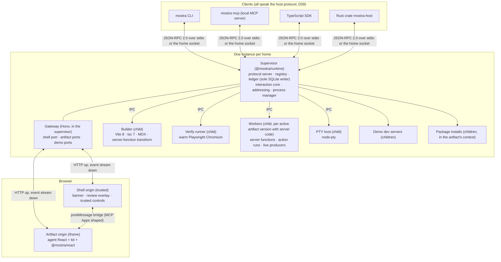

# Mostra architecture

**Status:** Settled architecture for v1, written by the C03-A phase design from the approved decisions in [DECISIONS.md](DECISIONS.md). It replaces the seed's architecture direction (commit `e1a5683`), whose approved content it keeps. Interfaces are specified in [INTERFACES.md](INTERFACES.md), stored data in [DATA_MODEL.md](DATA_MODEL.md), and failure, recovery and concurrency behavior in [FAILURE_MODEL.md](FAILURE_MODEL.md). Third-party facts are in [VERIFIED_FACTS.md](VERIFIED_FACTS.md). Every "Open for C03-A" question from the seed is resolved in [§15](#15-resolution-of-the-seeds-open-questions).

## 1. The shape in one page

Mostra has four kinds of caller:
- the **agent author**, who writes ordinary React (D04) and drives Mostra through the CLI, the local MCP server or an SDK;
- the **human viewer**, who uses a browser;
- the **host**, which embeds Mostra through the host protocol and ports;
- the **plugin author**, who implements extension contracts.

All four reach one **instance** per Mostra home (D45): a supervisor process with child processes it owns.

Load-bearing decisions:
- **The supervisor never runs artifact code** (RT-02). It parses manifests statically and delegates building, verifying, server code, PTYs and installs to child processes it supervises.
- **One owner per invariant.** The supervisor is the only writer of the ledger (D58, D71). Every transition that matters is one SQLite transaction: draft compare-and-set, submission creation, outbox enqueue, action-run state and event append.
- **Humans only see published, immutable versions** (D09). `mostra dev` is a separate developer path that never serves a capability URL.
- **Trusted controls render only in the shell origin** (D06, invariant 7). Artifact code can request them, never render or click them.
- **Hosts never touch storage or React.** They see domain objects through the protocol and optional ports (D58).

## 2. Artifacts

An artifact is ordinary React and TypeScript, or MDX (D04). The forms:
- a single `page.tsx` or `page.mdx` file, or a directory whose entry is `index.tsx` or `index.mdx`;
- an optional `pages/` folder for routing (D57);
- optional `"use server"` modules (D54) and `live.ts` live sources (D56);
- any components, data and assets.

No `package.json` is needed (AU-03). The manifest is a literal `defineArtifact({...})` in the entry, or frontmatter in MDX, and Mostra extracts it without running code (D51).

Persisted input is always a **field**, a value with an explicit, stable ID (D52):
- **viewer-scoped** by default: the viewer's draft (D39);
- **artifact-scoped** when declared: shared state that viewers, agents and hosts all write (D63).

Draft carry-over between versions, orphans (D42), conflicts and results are all defined per field ID.

An artifact's **submission policy** is requested by the manifest and decided by the host:
- `once` (scope `per-artifact` or `per-viewer`, D39);
- `epochs`;
- `none` (D63).

One-off artifacts (questionnaire, review, approval) and long-lived ones (a dashboard all week, a task manager) are two configurations of the same model, set mainly by policy and field scope (D63, D66).

Design is unbounded: the kit is a beautiful baseline, never a requirement (D68).

## 3. Versions, publishing and export

**Identity.** A version is identified by digests of its source tree and its environment (DATA_MODEL §2). Publishing the same source in the same environment twice yields the same version, so publish is idempotent. The output digest is recorded separately, and Mostra makes no claim of byte-identical rebuilds (VR-01).

**Publish** runs these steps, any of which can fail and leave no visible version (VR-02, D41):
1. Snapshot the source tree into staging.
2. Resolve and freeze dependencies into a lockfile (D20, D43).
3. Compute the digests.
4. Reuse the cached `verify` verdict for those digests, or run `verify`. Error-severity diagnostics refuse the publish unless `--force`, which records the failing codes in the version manifest.
5. Promote the verified build output (built once, by `verify`) into the content-addressed version store with an immutable manifest.
6. In one ledger transaction, insert the version, bind the artifact, and append `version.published`.
7. Return the receipt: artifact ID, version ID, version number, capability URL and an event cursor (H-07).

**Viewing.** A capability URL opens the shell for a version. When a newer version exists, open views show the banner (VR-04). Draft fields carry over by ID, and unmatched fields stay as orphans that the viewer can see and that the submission includes (D42). A viewer can choose "Always follow this artifact" (D63), which loads new versions automatically unless that would leave unsaved edits or create orphans.

**Retention.** Versions are kept unless `mostra gc` removes them, and gc never removes a version referenced by a submission, view or review set (VR-06, D47). Build caches are LRU-capped at 5 GB.

**Export classes** (VR-07):

| Class | Contents | Server features |
|---|---|---|
| `static` | the client build as files, hash-routed (D57) | None. Fields keep local state and say they can't be submitted |
| `html` | one self-contained HTML file | Same as `static` |
| `bundle` | client build, server bundle, manifest and lockfile: the **portable artifact package** (RM-01) | Run anywhere with `mostra run <bundle>` |
| `snapshot` | what a view showed, including field values and live values at a cursor | Actions marked unavailable, never faked |
| `mcp-app` | single-file `ui://` resource with declared CSP and the bridge transport (D61) | Through the local MCP server |

## 4. Process model

**Instance per home** (D45). A home is a directory chosen by the host (`MOSTRA_HOME`, `--home`, or the SDK's `home`), defaulting to `~/.mostra` on macOS and `${XDG_DATA_HOME:-~/.local/share}/mostra` on Linux. One supervisor owns a home, enforced by an exclusive SQLite lock on the home's ledger, which the operating system releases when the process dies (D81).
- **Lock and socket.** The control socket is how clients find the owner, never the lock. It lives in a short per-user runtime directory (`MOSTRA_RUNTIME_DIR`, `$XDG_RUNTIME_DIR/mostra/<home-hash>.sock` when that directory is safe, or `~/.mostra/run/<home-hash>.sock` on macOS, D82), because macOS limits socket paths to 104 bytes (VERIFIED_FACTS, process model). The owner records its PID, start time and socket in `instance.json` in the home, and re-creates the socket if the file disappears.
- **Races and stale sockets.** A starter that can't take the lock reads `instance.json` and attaches to the recorded socket. The lock holder simply replaces a stale socket file (FAILURE_MODEL §2).

**Two ways to run** (RT-06, H-12):
- **Attached daemon.** `mostra daemon start` (or the first CLI command that needs it) starts a detached supervisor (`mostra-runtime daemon`, D85). Clients attach over the socket. It keeps running while it has open views, active shares, pending deliveries, running producers or attached clients, and otherwise exits after 30 idle minutes. `mostra daemon install` registers a launchd or systemd user service for always-on artifacts (D62, D63).
- **Host-spawned.** `mostra host` (`mostra-runtime host` in the runtime bundle, D85) speaks the protocol over stdio and lives exactly as long as the connection. While it runs it also binds the home socket, so the CLI and MCP server inside that host's environment attach to the same instance (through `MOSTRA_HOME`).

**Children.** The supervisor's process manager starts, watches and reaps every child:
- builders;
- the verify runner;
- workers (one per active artifact version with server code; usually one per artifact);
- the PTY host;
- declared demo dev servers;
- package installs.

Each child runs in its own process group. Its PID and start time are recorded in the ledger, so a restarted supervisor reaps leftovers from a crash (FAILURE_MODEL §2). Frozen client-only versions need no process at all; the gateway serves their files (RT-05).

**Limits and lifecycles** are for stability, never security (D05, D62):
- **Workers:** 1 GiB heap and a 10 s event-loop watchdog by default, configurable per artifact. Evicted after 10 idle minutes. Restarted with exponential backoff after a crash, which is reported to the viewer and the event log (RT-04).
- **Verify runner:** keeps a warm Chromium and closes it after 10 idle minutes.

**Runtime distribution** (RT-01, H-13). Each platform (macOS arm64 and x64, Linux x64 and arm64) gets one signed, hash-pinned bundle: a private Node LTS (24 now, 26 after its LTS date, D48), prebuilt Mostra code, the warm package set, the Playwright Chromium headless shell, and native modules (better-sqlite3, node-pty, Rolldown, Lightning CSS).
- `npm create mostra`, `@mostra/cli`, the SDK and the Rust crate download it, check the SHA-256 manifest and cache it by hash.
- Every entry point runs on the private runtime, so users never need a global Node.
- Windows fails closed with `MOSTRA_PLATFORM_UNSUPPORTED` (D35).

## 5. The browser side

**Origins** (D21, D38, D70). The gateway listens on one port for the shell and on a stably leased port per opened artifact, all on the same loopback hostname. Shell and artifacts are therefore same-site but different origins.
- **Cookie mode.** A capability token in the launch URL is exchanged once for an origin-bound `HttpOnly; SameSite=Strict` session, and the token is stripped from the URL. The shell then hands the frame a single-use frame ticket, which the frame exchanges for its own session.
- **Worker mode.** Where shell and artifact are cross-site (Cloudflare quick tunnels in v1), the frame session uses a service worker plus ticketed streams instead.
- The addressing module picks the mode per origin pair. Artifact code never sees the difference.

**The shell** is a small trusted web app (`@mostra/shell`) on the shell origin. It owns:
- the artifact iframe;
- the version banner and the follow choice;
- the review overlay (pins, threads, review-set layouts);
- the submit, choose and approve trusted controls;
- the viewer chip;
- the save and delivery states (D47).

Its look is quiet by design, so the artifact is the work on show (D68). A host may theme it, or replace it by implementing the same bridge (D65).

**The client runtime** (`@mostra/react`) is compiled into every version. It provides fields, actions, live data, signals and `window.storage`, talks to the gateway over the **browser protocol** (INTERFACES §4), and talks to the shell over the bridge (INTERFACES §5). Published versions are immutable, so an old version's runtime keeps talking to newer gateways. The browser protocol is therefore a dated, additive protocol of its own.

**Transport** (D22, D47):
- Commands go up as authenticated JSON POSTs.
- One resumable event stream per view comes down, as SSE with a cursor, falling back to long-polling on the same cursor where SSE fails.
- WebSockets are used only for terminals.
- Offline edits go to an IndexedDB journal that replays in order on reconnect.
- BroadcastChannel only cuts latency between same-browser tabs. It is never a source of truth.

## 6. Interaction core

The supervisor's interaction module owns drafts, artifact state, submissions, signals, reviews, action-run bookkeeping, events and the outbox. Data shapes are in DATA_MODEL; behavior under failure and concurrency is in FAILURE_MODEL.

**Fields and documents.** A draft is the viewer-scoped document for (artifact, viewer). Artifact state is the artifact-scoped document. Both are maps from field ID to value with a per-field revision, under a monotonically increasing document revision.
- **Mutations** carry a client-generated mutation ID, the base revision and the viewed version.
- **Concurrency.** Non-overlapping field edits rebase automatically. A field edited elsewhere since the mutation's base becomes a conflict, returned to the writer and shown in the field's `meta`.
- **Idempotency.** Mutation IDs are idempotent.

**Submit** is one transaction (IN-05):
1. Resolve the view to its exact version.
2. Check the policy (`none` refuses; `once` checks uniqueness for its scope; `epochs` links to the previous epoch).
3. Check the expected draft revision.
4. Read the canonical persisted draft, plus artifact state at its current revision.
5. Compute the snapshot digest.
6. Insert the immutable submission with its channel, viewer and stale-view flag.
7. Enqueue one outbox delivery per registered submissions port.
8. Append `submission.created`.

A duplicate submit returns the existing submission (D22). A second submit under `once` returns a typed conflict carrying the existing submission (H-02). A submission is durable before any delivery attempt (IN-12, invariant 6).

**Delivery and the outbox** (IN-12, H-04):
- The dispatcher delivers each submission to each registered submissions port in order, idempotently by submission ID.
- Results: `accepted`, `rejected` (with a reason) or a transport failure. Failures retry with backoff, indefinitely while the host is registered as expecting deliveries.
- A host's rejection with reason `undeliverable` is terminal, and the viewer sees it.

The viewer sees `Submitted` (durable in Mostra), then `Delivered` or `Pending delivery`, or `Undeliverable` (IN-13, D47).

**Events** (IN-08). Every durable change appends an event, with a home-wide monotonic cursor and a per-artifact sequence. Hosts subscribe with a filter and a cursor and receive events in cursor order, without gaps across reconnects and restarts. Ephemeral traffic is never stored: presence, live updates (D63), action progress ticks and terminal output.

**Signals** (IN-09) are events with type `signal.raised`, raised by artifact code (`useSignal`), by server code (`signal()`), or by the shell for submit. Mostra never decides what wakes an agent. Hosts filter.

**Wait and results** (IN-10, IN-11):
- `wait` blocks until a condition holds or the timeout passes. Its conditions are `submitted`, `signal:<name>`, `state:<field>` and `event:<type>`.
- `submitted` is level-triggered: satisfied by any existing submission in the current epoch. The others are edge-triggered after a cursor, defaulting to the cursor of the artifact's latest publish.
- On timeout it returns `still_waiting` with a cursor and loses nothing.
- `results` assembles the complete submission (INTERFACES §8) as JSON and as Markdown for agents.

## 7. Server code: actions, live data, state

**Workers** (`@mostra/worker`) load a version's server bundle and execute:
- server functions;
- action runs;
- live producers.

The gateway (Hono) authenticates the browser request, then forwards a typed call over IPC with the request context (viewer, view, version, run). The worker runs it inside AsyncLocalStorage (D19 seam 3). Workers never see cookies, tokens or raw browser requests.

**Plain calls and action runs** (D54):
- A direct call is a plain RPC.
- `useAction` creates an `ActionRun`, recorded by the supervisor before the worker starts it. A run moves through `queued`, `running` and a final state (`succeeded`, `failed` or `cancelled`), with progress, log (capped at 1 MB, D47) and partial results streamed to the page.
- Runs outlive the tab and re-attach. Explicit keys are unique per (artifact, action, key), so a duplicate invocation joins the existing run (AC-03).
- Cancellation reaches the action as an `AbortSignal` (AC-04).
- A run cut off by a worker crash ends `failed` with reason `interrupted`. Mostra never retries it implicitly (D24).

**Live sources** (D56, D63):
- **Producers** run in the worker of the latest published version that defines them, while a view or host subscription exists, or always with `always: true`. Pushes from the CLI, SDK or protocol write the same sources.
- **Storage.** The latest value persists with a revision, and an optional ring buffer keeps the high-rate window (AC-08).
- **Delivery.** Updates go out as ephemeral stream notifications, and a reconnecting view receives the latest value.

**Artifact state from the server.** `state` in `@mostra/server` and `mostra state` in the CLI write the artifact-scoped document through the same compare-and-set path as viewers (D63). A task-manager action that adds a task is one state mutation with its own mutation ID.

**Secrets** (D44) are resolved by name through the secrets port, defaulting to the home's 0600 store. Values reach server code only through `secret()`. Mostra redacts them from logs, diagnostics, events, exports and screenshots.

## 8. Review

Review lives in the shell's overlay (D23). Comments anchor with every applicable layer:
- the semantic `data-review-id`;
- W3C selectors (CSS and text quote);
- frame-relative coordinates with viewport and DPR;
- a screenshot crop, which is always stored.

The crop comes from the capture port. The default captures through the verify runner's browser at the view's version, viewport and field values, plus the viewer's own rendered pixels where the bridge can supply them.

Special anchors:
- kit charts map clicks to series and datum;
- terminals use cell rectangles plus recording time;
- timelines and video use time plus region;
- slides use slide and step.

Frames Mostra serves (including proxied demos, D65) get the injected bridge, so their content anchors semantically. Opaque frames fall back to coordinates and crops.

Threads have replies, resolve and reopen, and record each message's author (D47). Review sets lay candidates out as gallery, focus or synchronized compare. Choose is a trusted control whose result is the field `review.<set>.choice` (D65). `mostra review export` writes Markdown and JSON with crop paths (RV-05).

## 9. Terminals and web demos

One frame model (cells, styles, cursor, size, timing, width table) underlies all four modes (D28, D65):
- **Recorded:** asciicast v3 bytes replayed through `@xterm/headless` with Unicode 11 widths into frames, drawn by Mostra's `<TerminalGrid>` with a bundled font and procedural box drawing.
- **Captured:** ratatui buffers from the `mostra-term-capture` crate, with widths taken from ratatui.
- **WASM:** a Ratzilla iframe island that reports frames over the bridge.
- **Live:** a declared PTY session from the PTY host, rendered by xterm.js 6 with WebGL behind the embed-engine contract, and teed into an asciicast v3 recording.

`mostra term dump` and terminal lint give agents text, cells and ANSI output without vision (TM-06).

Web demos are declared in the manifest. The gateway proxies each one on its own leased port origin, with HTTP and WebSocket passthrough, header rewriting where needed, framing headers stripped from that demo's responses only, and the bridge injected unless turned off (TM-08). The kit's `<WebDemo>` adds device frames and viewport switching.

## 10. Hygiene and remote viewing

The 13-point checklist (seed §11, D06) is implemented in the gateway and the MCP HTTP transport, and verified by negative tests (HY-01):
- loopback bind by default; wider binds need an explicit flag (HY-02);
- an exact Host allowlist, including registered tunnel hostnames only;
- exact Origin checks on every non-GET request, stream and WebSocket upgrade;
- capability tokens of at least 128 bits, exchanged for sessions and stripped from URLs;
- CSRF tokens plus JSON content types on mutations;
- no permissive CORS, `Cross-Origin-Resource-Policy: same-origin`, `Referrer-Policy: no-referrer`;
- per-scope tokens (`view`, `draft`, `submit`, `action:<name>`, `review`) that expire, rotate and revoke (410 when revoked), with rate-limited guessing (HY-03);
- capability URLs redacted everywhere;
- side-effect-free GETs; robust header parsing.

The gateway strips Mostra's cookies before proxying to workers, demos or terminals (D38). Local capability URLs don't expire by default (D63).

**Sharing** (D47, HY-04, HY-05) drives the installed tools and registers their hostnames with the Host allowlist:
- `mostra share --tailnet` uses Tailscale Serve and maps the identity headers to viewers. The backend stays on loopback so the headers can't be spoofed.
- `mostra share --public` uses Tailscale Funnel (ports 443, 8443 and 10000: the shell plus up to two artifacts) or a Cloudflare quick tunnel (worker-mode frames, D70). Public shares always use short-lived scoped tokens.
- The event stream falls back to long-polling where SSE doesn't pass. Cloudflare quick tunnels don't support SSE (VERIFIED_FACTS).
- When a tool is missing, Mostra explains how to install it.

## 11. Host integration

Hosts integrate through the **host protocol** (D59, INTERFACES §6) and **optional ports** (D58, INTERFACES §7). Every port has a standalone default, so a host that registers none behaves like the CLI:

| Port | Standalone default | Jcode's expected use (C03-B, JCODE_HOST) |
|---|---|---|
| `identity` | single local user; Tailscale header mapping | map its tunnel identity (H-05, H-14) |
| `submissions` | accept immediately | deliver into `session_work_v1`; `rejected: undeliverable` for gone sessions (H-01 to H-04) |
| `drafts`, `reviews` | none | optional opaque mirrors |
| `events` | read by `wait` and `results` | subscribe to `submission.created` only (H-09) |
| `addressing` | loopback ports, tailnet and public shares | publish tunnel hostnames (H-14) |
| `trustedControls` | shell renders submit and choose; both channels allowed | shell-only submit (H-05) |
| `capture` | verify runner's browser | default |
| `secrets` | home store | its credential store |
| `pty` | PTY host | default or its own PTYs |

The **Rust crate** `mostra-host` has wire types generated from the schema, a hand-written tokio client, spawn and attach, runtime-bundle download and cache, and port traits (HO-03). The **TypeScript SDK** has `createMostra({ home, ports })` (HO-04). The **conformance kit** (HO-05) runs scenarios against a host, with expected-failure baselines. JCODE_HOST's H-01 to H-16 map to generic mechanisms only (HO-06, [JCODE_HOST.md](JCODE_HOST.md#how-mostra-meets-each-need)).

## 12. Agent experience

- **`verify`** (D29, D65): type-check and build; lint, including wrong-base idioms, churned APIs and field IDs; boot; render in the warm browser; collect errors, console, network and React boundaries; axe and an ARIA snapshot; screenshots at 1280×800 and 390×844, DPR 1, with token estimates; the smoke test (actions only through `dryRun()`, D55; observations without a runtime error are warnings, D72); regressions against the last passing version; one JSON verdict with stable `MOSTRA_<AREA>_<NAME>` codes.
- **The CLI** (D60) is a thin protocol client with `--json` everywhere, documented exit codes and no prompts outside a TTY.
- **The local MCP server** (D61) is a stateless protocol client with about twelve `artifact_`-prefixed tools.
- **Documentation for agents:** the Skill (trigger D69), AGENTS.md in the repository and every scaffolded artifact, templates per family (including long-lived ones), a gallery with source and result, generated `llms.txt`, and harness plugins generated from one source (D65).

## 13. Extensibility

Six contract packages at 0.x (D65): embed engine, exporter, verify check, anchor provider, connector, CLI command. Plugins declare them under the `"mostra"` key in `package.json`, with declared (never enforced) effects and license metadata. The non-OSI license acknowledgment is recorded in the lockfile (D31). Packs are shadcn registry items with an optional `mostra` block. The `RenderMode` contract stays internal, with SPA as its only v1 implementation (D19 seam 5). First-party plugins prove the contracts:
- the xterm.js engine;
- the MCP App exporter;
- the Remotion and GSAP adapters (user-installed, license flow);
- chart datum anchors;
- a filesystem connector;
- `mostra term record`.

## 14. Render modes and remote readiness

**Render modes** (D19). SPA is permanent and first-class (RS-02). The five v1 seams make RSC additive (RS-01):
1. the manifest's `mode` (default `spa`);
2. `"use server"` functions with React's serializable type set (D54);
3. AsyncLocalStorage request context in workers;
4. a client runtime whose modules carry `"use client"`, with no environment-assuming singletons and client-only bridge access;
5. the internal `RenderMode` contract (INTERFACES §11).

A later `rsc` mode adds rsc, ssr and client builder environments (`@vitejs/plugin-rsc`), a Flight handler in the worker behind capability authentication, prerender-only MCP App export and server-render error capture in `verify`. Versions, submissions, review, the host protocol, the gateway and `verify`'s browser stages stay unchanged. Old versions never migrate; an artifact opts in with a new version.

**Remote readiness** (D12, RM-01). v1 builds the seams that remote mode (v1.x) uses:
- the portable `bundle` export (§3);
- identity, addressing and every other port (D58);
- worker mode for cross-site frames (D70);
- the `WorkerLauncher` interface that becomes `SandboxPort` (INTERFACES §7);
- a stateless MCP server with explicit handles (D61).

The remote server itself (Streamable HTTP MCP for the 2025-11-25 and 2026-07-28 revisions, OAuth with CIMD, DCR and refresh tokens, revisioned file push, server-side build jobs, wildcard origins) gets its own design pass at v1.x.

**Layers stay usable on their own** (D01, D30): the kit without the runtime, the runtime with any components, and any host through the ports.

## 15. Resolution of the seed's open questions

| Seed section | Question | Resolution |
|---|---|---|
| §2 | Manifest form; field identity; routing | D51; D52; D57 |
| §3 | Retention and GC; publish and verify; banner with unmappable fields | D47; D41; D42 and D63 (follow) |
| §4 | Instance model; eviction, restart, limits; home location and override | D45, §4; D62; §4 and HO-08 |
| §5 | Serialization set; `*.server.ts`; `RenderMode` methods | D54; D54 (no); D65 (ROUND-3 §7), INTERFACES §11 |
| §6 | Auto-install or explicit add; kit declaration; import-map mode | D43; D65 (ROUND-3 §1.1); D47 (v1.x) |
| §7 | Draft scope; event retention; client runtime API; programmatic submit; outbox semantics; `window.storage` | D39; D47; D52, INTERFACES §2; D40; §6, FAILURE_MODEL §4; D53 |
| §8 | Secrets; dry-run; action-run retention | D44; D55; D47 |
| §9 | Threading; bridge in foreign apps; review export format | D47; D65 (on by default); INTERFACES §8 |
| §10 | Shell visual design; bridge message set; replaceable shell | D68 (direction accepted; final pass in its WP); D65, INTERFACES §5; D65 |
| §11 | Share commands and hostname registration; drive tools or print instructions | D60, §10; D47 (drive, explain when missing); D70 for cross-site tunnels |
| §12 | Extra transports; schema source; versioning; mandatory ports; AI port | D59 (stdio and Unix socket); D59 (Zod 4); D59 (dated revisions); D58 (all optional); D46 (out of v1, name reserved) |
| §13 | Default base; final kit list; questionnaire; maps and 3D; deck grammar; composition primitive | D72 (Base UI, EVAL-01); D65, D72 and VERIFIED_FACTS; D65; D65 (on demand); D65; D65 |
| §14 | PTY implementation; headless emulator; frame schema; ghostty-web | D65 (node-pty in a PTY host behind the `pty` port); D65 (`@xterm/headless`, Unicode 11); D65, INTERFACES §10; watch list behind the embed-engine contract |
| §15 | Command set; diagnostics catalog; smoke scope; regression baseline; viewports; warm browser; Skill structure; harness plugins | D60; D65 (scheme), catalog grown per WP; D65; D65; D65; D65; D69 and ROUND-4; D65 |
| §16 | Tool list; MCP Apps storage; per-host conformance; further interop | D61; D61; D65; D47 (v1.x) |
| §17 | Contract list; manifest schema; pack format; first-party plugins; loading order | D65 |
| §18 | v1 remote seams | §3 (portable bundle), D58 (ports), INTERFACES §7 (`WorkerLauncher` becomes `SandboxPort`), D61 (stateless MCP) |
| §19 | Package map | D65 (P2), [REPO_STANDARDS.md](REPO_STANDARDS.md#3-packages) |
| extra | D33 confirmation; Windows; publication authorization; evaluation budget | D34; D35; D36, D67; D34, D64 |
