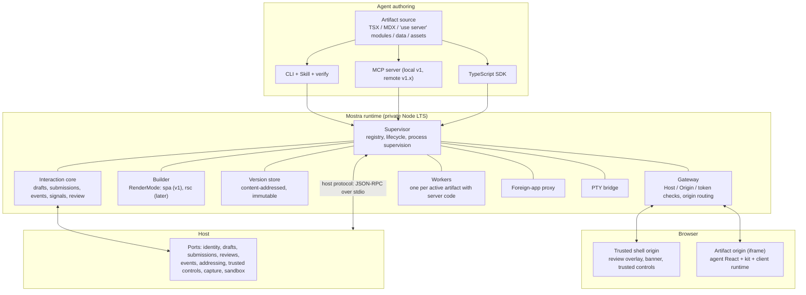

# Mostra architecture direction

**Status:** Approved direction, not a finished design. Each section states what Mirza approved (with decision IDs from [DECISIONS.md](DECISIONS.md)) and ends with **Open for C03-A**: questions the phase design settles with Mirza, each with a starting recommendation. C03-A turns this into the implementation-ready architecture, interfaces and work packages. It also compares at least two structurally different candidates wherever a section leaves the shape open ([STANDARDS.md](STANDARDS.md#design)).

Facts about third-party projects come from the research reports ([research/INDEX.md](../research/INDEX.md)) as of October 2026. Re-verify them before depending on them.

## 1. System overview



Every layer is usable on its own: the kit without the runtime, the runtime with any components, any host through the ports (D01, D30).

## 2. Artifact model

**Approved.**
- An artifact is ordinary React and TypeScript, with MDX for document-heavy pages (D04).
- It can be a single TSX or MDX file (instant start) or a directory with pages, components, `"use server"` modules, data and assets.
- No `package.json` is required. Dependencies resolve as in section 6 (D20).
- The artifact declares a render `mode`, which defaults to `spa` (D19).
- Every persisted input has a **stable field ID**. Draft carry-over across versions depends on it (D09).
- Artifacts may carry free-form metadata: title, description, a `family` label (for example questionnaire, proposal, prototype, presentation, dashboard, demo, custom) and links to related artifacts (for example "round 2 of"). Hosts may read the metadata, and Mostra never restricts it.

**Open for C03-A.**
- **Manifest form.** A `mostra.json` file, a typed `artifact.config.ts` using `defineArtifact({...})`, or frontmatter for single-file artifacts. *Recommendation:* typed config with a JSON-equivalent schema, plus frontmatter for single files.
- **Field identity.** Explicit `id` props, IDs derived from position, or both with lint warnings. *Recommendation:* explicit IDs required for persisted inputs. `verify` reports missing or duplicate IDs.
- **Multi-page routing** inside one artifact: whether to use React Router minimal mode or a small built-in router.

## 3. Versions and publishing

**Approved (D09, D18, D20, D22).**
- **Content-addressed identity.** Hash the normalized source tree, the lockfile, the Mostra and kit versions, the render mode and the build configuration, and record the actual output digest separately. Don't claim byte-identical rebuilds without auditing build determinism. Brief 2-second's split into source, environment and build revisions is the reference.
- **Publish is atomic.** Snapshot the source, freeze dependencies, build for production, hash the outputs, write an immutable manifest, then update the registry atomically. A failed publish leaves no visible version.
- **Humans see versions only.** A viewer opens a version through its capability URL. When a newer version exists, the shell shows a "new version available" banner, and switching is the viewer's choice. Draft input carries over through stable field IDs. Inputs whose IDs disappeared stay in the draft history, marked orphaned, and are never silently dropped.
- **Retention.** A version referenced by any submission, view or review set is never garbage-collected.
- **Static export classes.**
  1. A pure client artifact exports to static files or a single HTML file.
  2. An artifact with server code exports as a runnable bundle containing client assets plus the server bundle and manifest.
  3. A "snapshot archive" preserves what was shown, with actions explicitly marked unavailable.

  Export never pretends that a server-backed button still works in static HTML.
- **Hot reload** exists only as an optional developer mode (`mostra dev`). It is never the path a human viewer uses.

**Open for C03-A.**
- Retention and garbage-collection policy for unreferenced versions and build caches.
- Whether `publish` runs `verify` automatically, and what happens when verify fails. *Recommendation:* publish refuses on failing compile-phase diagnostics, warns on other findings, and has an explicit override flag.
- Banner behavior when the newer version can't map some draft fields.

## 4. Process model

**Approved (D18).**
- **One supervisor per Mostra instance.** It holds the artifact registry and version store, supervises child processes and serves the gateway. It never imports artifact code.
- **Gateway** (Hono): Host allowlist, Origin and token checks, routing by origin, static serving of versions, the event stream, and proxying to workers, foreign apps and PTYs.
- **Workers** are child processes, one per active artifact with server code, started lazily and stopped after idle. A crash, infinite loop or memory blow-up in one artifact never takes down the gateway or another artifact. Limits exist for stability, not security (D05).
- **Frozen client-only versions** need no process. The gateway serves their files.
- **Runtime distribution.** Each platform gets a signed, hash-pinned runtime bundle: Node LTS, prebuilt Mostra code and native modules. Hosts download and cache it by hash, the way Playwright manages browsers. A single-binary launcher can come later. Bun stays a CI target.

**Open for C03-A.**
- **Instance model.** One shared Mostra instance per user versus one per host. *Recommendation:* the supervisor supports being spawned by a host over stdio as well as running as a standalone daemon that the CLI attaches to. C03-A defines how several hosts or CLIs on one machine find or share instances.
- Idle-eviction and restart policies, and the exact resource limits.
- Where artifact sources, versions and caches live by default (a Mostra home directory), and how a host overrides that through addressing and storage configuration.

## 5. Render modes and RSC readiness

**Approved (D19).**
- SPA is the permanent default mode.
- RSC arrives as an additive `rsc` render mode once its triggers hold.
- The five seams are v1 requirements: a `mode` field, the `"use server"` contract, AsyncLocalStorage request context, an RSC-safe client runtime and the `RenderMode` contract.

**What RSC would add later:**
- a builder with separate rsc, ssr and client environments (Vite's Environment API through `@vitejs/plugin-rsc`);
- a Flight request handler in the worker;
- exporter rules (RSC artifacts export to MCP Apps only when prerendered);
- server-render error capture in `verify`.

**What stays unchanged:** versions, submissions, the review layer, the host protocol, the gateway and `verify`'s browser stages.

**Open for C03-A.**
- **Exact serialization type set** for server function arguments and results. *Recommendation:* adopt the set React Flight supports, and use one serializer for RPC so behavior doesn't change when an artifact switches modes.
- **Whether to also accept a `*.server.ts` file convention.** *Recommendation:* `"use server"` only. One way to do each thing.
- **The `RenderMode` contract's methods** (build, serve, export, capabilities). Framework adapters (TanStack Start, Next) would implement the same contract later as foreign-app integrations.

## 6. Dependencies

**Approved (D20).**
- The curated, pre-warmed set resolves for every artifact with one React copy.
- Unknown imports install on demand into a shared content-addressed store with a per-artifact lockfile.
- The lockfile hash is part of version identity.
- Offline use is explicit: a missing package is an error.
- Lifecycle scripts run in the artifact's execution context.
- pnpm's `pnpr/` (PolyForm Shield) is excluded.

**Open for C03-A.**
- Auto-install on first import versus an explicit `mostra add <pkg>` with a structured error. *Recommendation:* auto-install by default, with a host policy switch to require explicit adds.
- How kit packages are declared so that copy-source packs and the warm set don't diverge.
- An optional import-map/CDN mode for tiny artifacts.

## 7. Interaction core

**Approved (D10, D11, D22).**

**Objects** (brief 5-second has full type sketches):
- `ArtifactVersion`.
- `View` (version shown, opened time, optional live-data cursors).
- `Draft` (per artifact and viewer scope; revision; value).
- `DraftMutation` (stable mutation ID, expected revision, viewed version, patch).
- `Submission` (immutable; version, view, draft revision, snapshot and its digest, actor, time, epoch).
- `Event` (stable ID, per-artifact sequence, type, actor, causation, payload).
- `ActionRun`, `ReviewSet`, `Comment`, `LiveSource`.

**Rules:**
- Writes are compare-and-set on the draft revision. Mutation IDs are idempotent. Non-overlapping field edits rebase automatically. Overlaps return an explicit conflict.
- Autosave is debounced and flushes on blur, on visibility change and before submit.
- Multi-tab sync happens through the event stream, with BroadcastChannel only as a latency optimization.
- Offline edits go to an IndexedDB journal that replays in order on reconnect. A mutation authored against a structurally incompatible version needs ID mapping or is reported. It is never silently replayed.

**The submit transaction.** Resolve the view to its exact version. Verify the expected draft revision. Read the canonical persisted draft. Compute the snapshot digest. Insert the immutable submission (unique per epoch under `once`). Emit `submission.created`. A duplicate submit returns the existing submission.

**Submission policy** is per host: `once` or `epochs`.

**Events and signals.**
- Every durable change emits an event.
- Ephemeral activity (presence, cursors, animation frames, terminal deltas) is explicitly ephemeral.
- Hosts subscribe with filters and a durable cursor, and decide what each event means.
- Signals are events raised on purpose: Submit, plus author-defined signals from the client runtime or from actions.

**Waiting and results.** `wait` (CLI, MCP, SDK and protocol) blocks until a submission, a named signal or a timeout. A timeout returns a resumable status and loses nothing. `results` returns the complete submission: draft snapshot, choices, comments with anchors and screenshot crops, version IDs and action-run references. It comes as JSON plus a Markdown rendering designed for agents.

**Host outages.** When a host owns storage (section 12) and is unreachable when the human submits, Mostra persists the submission in a local outbox, tells the viewer it is accepted and pending delivery, and replays idempotently when the host returns. "Accepted by Mostra", "accepted by the host" and "consumed by the agent" are different facts. Mostra reports the first two and the host owns the third.

**Open for C03-A.**
- **Draft scope.** One draft per artifact and viewer identity, or per view. *Recommendation:* per artifact and viewer, so a refresh or a second device continues the same draft.
- **Event retention and compaction:** snapshot plus cursor when history is compacted.
- **The client runtime API** (`useDraft`, `useField`, `useSubmit`, `useSignal` and similar). Write the caller's usage first ([STANDARDS.md](STANDARDS.md#design)).
- **Whether author code may submit programmatically** when a host has no trusted-controls requirement.
- **Exact outbox semantics** and the viewer-visible states.
- **A `window.storage`-compatible shim** over drafts (design input from research brief 1). Claude Artifacts taught agents that small key-value API, so a compatible shim would let that habit carry over.

## 8. Actions and live data

**Approved (D24, D08).**
- **Actions** are `"use server"` functions invoked through the client runtime, for example `useAction(sendReply)`.
- **Full capability:** secrets come from the server environment, and network, filesystem and process access are unrestricted.
- **Durable `ActionRun`:** states are queued, running, succeeded, failed and cancelled. Progress, log and partial events stream to the page. Runs outlive the tab and can be re-attached.
- **Idempotency:** the client generates the key when the button is clicked. The server de-duplicates on artifact, action and key.
- **Cancellation:** an AbortSignal reaches the action.
- **Emitting:** an action may emit a host event or a signal.
- **Live data:**
  - loaders with polling, streams or file watching;
  - push from the CLI or SDK (`mostra push <artifact> <key> --json data.json`);
  - one `useLive(key)` hook built on `useSyncExternalStore`;
  - data flows over the artifact's event stream, never over HMR channels.

**Open for C03-A.**
- **Secrets handling.** Per-artifact secrets in a secrets store bound by name, or environment passthrough from the host. *Recommendation:* named secrets set through the CLI or host, never stored in artifact source.
- **Dry-run semantics for actions during `verify`** smoke tests. *Recommendation:* actions declare an optional `dryRun` handler, and without one `verify` skips invoking them and reports the skip.
- Action-run retention.

## 9. Review layer

**Approved (D23).**
- Review is an overlay in the trusted shell above the artifact iframe. Agent CSS and JavaScript can't hide or forge it.
- Anchors resolve in order: `data-review-id`, then W3C Web Annotation selectors (CSS plus text quote), then frame-relative coordinates with viewport and device-pixel ratio, then a screenshot crop of the region. The crop is always stored, because agents can't see the browser.
- **Content types:**
  - Kit charts and canvases map clicks to semantic targets (series, datum).
  - Terminals anchor to cell rectangles plus recording time.
  - Video and motion anchor to time plus region.
  - Iframes that Mostra serves get an injected bridge script.
  - Opaque cross-origin iframes fall back to coordinates and screenshots.
- **Review sets:** gallery, focus view, synchronized side-by-side compare (two to four candidates, optional pixel diff) and choose-one. A choice and its comments are part of the draft and arrive with the submission.

**Open for C03-A.**
- Comment threading and resolution in single-user versus multi-viewer cases.
- Whether proxied foreign apps get the bridge script injected.
- The export format for agents (`mostra review export --format md|json`, with crop paths).

## 10. Shell, origins and trusted controls

**Approved (D06, D21).**
- The shell runs on its own origin and wraps the artifact iframe. It owns:
  - the version banner;
  - the review overlay and toolbar;
  - viewer identity display;
  - the Submit control;
  - other trusted controls a host enables (approve, reject, choose).
- The artifact can **request** a trusted control (for example label "Submit & Send") but can't render, click or spoof one.
- Hosts without provenance needs may let the artifact render its own submit button through the client runtime. That is the host's choice.
- **Origins:** one origin per artifact (`<artifact>.localhost:<port>`), with a port-per-artifact fallback for Safari.
- Communication between shell and artifact is a validated JSON-RPC `postMessage` bridge, shaped like the MCP Apps bridge so export stays a transport swap.

**Open for C03-A.**
- The shell's visual design. It must be beautiful, unobtrusive and consistent with the kit, and Mirza reviews it.
- The bridge message set.
- Whether the shell's chrome can be themed or replaced by hosts that render their own shell, such as a desktop app embedding the artifact directly.

## 11. Hygiene and remote viewing

**Approved (D06, D12).** The v1 checklist, from research briefs 5, 5-second and 6:
1. Bind to `127.0.0.1` and `::1` by default. Wider binds need an explicit flag.
2. Exact Host allowlist: `localhost`, `*.localhost`, loopback IPs and explicitly registered tunnel hostnames. There is never an "allow all" switch.
3. Exact Origin check on every non-GET request, SSE connection and WebSocket upgrade. No unanchored patterns.
4. A capability token of at least 128 bits from a CSPRNG in the launch URL. It is exchanged once for an `HttpOnly`, `SameSite=Strict` cookie scoped to the artifact origin, then stripped from the URL.
5. A CSRF token on mutations, plus JSON content types that force a preflight.
6. No wildcard or reflected CORS. `Cross-Origin-Resource-Policy: same-origin`.
7. `Referrer-Policy: no-referrer`.
8. Per-artifact, per-scope tokens (view, draft, submit, `action:<name>`, review), so a view-and-comment link can't press Send.
9. Token expiry, rotation and revocation (410 when revoked). Rate-limit token guessing.
10. Never log full capability URLs.
11. GET requests have no side effects. Actions are POST with idempotency keys.
12. Robust header parsing.
13. The same rules apply to the local MCP server's HTTP transport.

Chrome's Local Network Access prompt is defense in depth, never the defense.

**Remote-viewing ladder (v1):**
1. **Tailscale Serve.** Tailnet-only HTTPS. Identity headers map to viewer identity, and the backend stays on loopback so the headers can't be spoofed.
2. **Quick public share.** Tailscale Funnel or a Cloudflare quick tunnel, only behind an explicit flag, with short-lived scoped tokens.
3. **Static export** to any static host for client-only artifacts.

**Open for C03-A.**
- The exact commands (for example `mostra share --tailnet`, `mostra share --public --ttl 2h`) and how tunnel hostnames are registered with the Host allowlist.
- Whether Mostra drives `tailscale serve` and `cloudflared` itself or prints instructions. *Recommendation:* drive them when installed, with a clear explanation when they are missing.

## 12. Host integration

**Approved (D01, D25, D32).**

**Ports:**

| Port | Responsibility | Standalone adapter |
|---|---|---|
| Identity | Who is viewing or acting | Single local user; Tailscale header mapping |
| Drafts | Revisioned draft storage with compare-and-set | Embedded transactional store (SQLite recommended) |
| Submissions | Immutable submission creation and reads, idempotent | Same store |
| Reviews | Comments and review-set state | Same store |
| Events | Delivery of events and signals to the host; optional host-to-Mostra events (for example agent-pushed data) | Local log plus CLI `wait` and `results` |
| Addressing | URLs, origins, tunnel hostnames, capability minting and revocation | `*.localhost` plus port fallback |
| Trusted controls | Which trusted controls appear; receiving their activation | Mostra's own shell |
| Capture | Screenshots and accessibility snapshots on request | Built-in Playwright |
| Sandbox (v1.x) | Where artifact server code runs in remote mode | Local process |

**Host protocol and libraries:**
- **Host protocol:** versioned and language-neutral, with capability negotiation, JSON-RPC 2.0 messages and stdio as the required transport. It is defined as a schema from which TypeScript and Rust wire types are generated or checked.
- **Rust host crate:** wire types, a client, process management for the runtime bundle, and port traits.
- **TypeScript SDK:** `createMostra({ ports })` for JavaScript hosts.
- **Conformance kit:** scenario-based. It covers storage durability across restart, exactly-once-in-effect submission delivery, outbox replay after host outage, identity propagation, addressing, trusted-control round trips, hygiene rejections (bad Host, bad Origin, missing token) and version negotiation. It supports expected-failure baselines.
- **Host boundary:** hosts never touch React internals or Mostra's storage formats. They see domain objects through ports.

**Open for C03-A.**
- **Additional transports.** *Recommendation:* stdio required; a Unix socket optional for long-lived daemons that hosts attach to after starting.
- **Schema source of truth:** TypeSpec, TypeScript-first with generated JSON Schema 2020-12, or Zod. Rust codegen has limits (typify is Draft-7-centric), so constrain the schema subset and hand-write the client.
- **Protocol versioning:** date-based revisions like MCP, or semver. *Recommendation:* date revisions with a 12-month deprecation window.
- **Which ports are mandatory and which are optional** per host capability set.
- **An optional AI port** (design input from research brief 1-second). It would let artifacts call a model through the host's own session or provider instead of embedding credentials, like Claude's AI-in-artifact feature. It is never mandatory.

## 13. Kit and design system

**Approved (D26, D27).**
- **Default kit:** shadcn/ui on Tailwind CSS 4 with OKLCH tokens and dark mode, plus the charts, tables, forms, diagrams, maps, 3D, code, math and motion libraries listed in D26.
- **Several shadcn bases** (Base UI, Radix, later React Aria) ship as registry variants, one base per artifact. Higher-level kit components use public component APIs and a `Slot` adapter.
- **One token system:** charts (`--chart-*`), uPlot and ECharts wrappers, CodeMirror and Shiki themes and map styles all read it. Hosts can inject brand themes.
- **Theme variables** align with the MCP Apps host-context variable names, so artifacts theme correctly inline.
- **Questionnaire and form components** cover single and multi choice with a recommended option, ranking, scales, free text, per-item comments, required items, sections and progress. They are built on react-hook-form and Zod, persisted through drafts, and remain ordinary React the agent can replace.
- **Motion:** Motion for UI animation. Mostra's own frame-based **composition primitive** handles motion graphics: compositions with fps and duration, sequences, `useFrame`, `interpolate` and `spring`, with play, scrub and loop controls, rendering ordinary DOM, SVG and canvas. Its API shape follows Remotion's familiar model, but with no Remotion dependency. Have the naming checked so it doesn't copy Remotion's identifiers wholesale.
- **Decks:** Mostra's own MDX deck runtime with Slidev-style grammar (`---` breaks, frontmatter layouts, click steps), presenter view, print to PDF, and Shiki, KaTeX and Mermaid blocks.
- **Model fluency against API churn:**
  - pin versions;
  - ship "write this, not that" tables in the Skill and docs (for example `motion/react` not `framer-motion`, `@xyflow/react` not `reactflow`, Tailwind 4 `@theme` not `tailwind.config.js`, Zod 4 top-level formats);
  - add lint rules with autofixes that `verify` runs.

**Open for C03-A.**
- The default base, chosen by evaluation (D27, D33).
- The final kit list after re-verifying versions and licenses.
- Questionnaire component API and design.
- Whether maps and 3D are in the warm set or install on demand.
- The deck runtime's exact grammar.
- The composition primitive's API.

## 14. Terminal and web demos

**Approved (D28).**
- **A normalized terminal frame model** (cells, styles, cursor, size, timing) and Mostra's own `<TerminalGrid>` renderer for static, recorded and WASM-snapshot content. The renderer bundles its font, draws box-drawing and block glyphs procedurally and pins one Unicode-width table.
- **Live:** a PTY bridge feeding xterm.js 6 with WebGL, behind a terminal-engine adapter, with recording into asciicast v3.
- **Recorded:** asciicast v3 is the interchange format, replayed through a headless emulator into frames.
- **WASM:** Ratzilla template for ratatui.
- **Capture:** a Rust crate exports a ratatui TestBackend buffer and scripted key sequences into frames.
- **Agent checks:** `mostra term dump --format text|cells|ansi` plus screenshots, and lint for misaligned borders, overflowing cells and width disagreements.
- **Component family:** `<Terminal mode="live|recording|wasm">`, `<TerminalCompare>` with synchronized playback and cell diff, and annotations on cell rectangles.
- **Web demos:**
  - run the project's own dev server and reverse-proxy it on its own origin, with HTTP and WebSocket passthrough and Host rewriting where needed;
  - strip framing headers only from that demo's responses;
  - provide device frames, viewport switching and screenshots;
  - in-browser bundling (Sandpack, esbuild-wasm) is only an optional snippet mode;
  - WebContainers and Nodebox are excluded from the core (commercial terms).

**Open for C03-A.**
- **PTY implementation:** node-pty inside the Node runtime, or a Rust PTY helper binary. *Recommendation:* node-pty isolated in its own process, with a port so hosts like Jcode can supply PTYs instead.
- **Headless emulator for recordings:** avt or `@xterm/headless`, decided by a fidelity fixture suite.
- The terminal frame schema.
- ghostty-web as a second engine (watch list).

## 15. Agent experience

**Approved (D17, D29).**

**CLI:**
- Commands such as `mostra new | dev | verify | publish | open | share | wait | results | review export | push | term dump | add | export | doctor | docs | mcp | plugin`.
- `--json` on every command (NDJSON for streams), documented exit codes, no prompts when not on a TTY or in JSON mode.
- Logs go to stderr. Commands are idempotent. Long operations emit progress events.

**`verify` pipeline** (brief 6):
1. Type-check and build with errors mapped to diagnostics.
2. Lint for known pitfalls and churned APIs.
3. Boot on a random loopback port with a token.
4. Render headlessly in a warm Playwright Chromium instance, waiting for a Mostra readiness signal.
5. Collect page errors, console errors and warnings, failed requests and React error boundaries.
6. Run axe-core accessibility checks and capture an ARIA snapshot.
7. Take screenshots at desktop and mobile viewports, at device-pixel ratio 1 by default, with a token estimate per image.
8. Run the synthetic smoke test: click enabled controls, fill forms from schemas, flip slides, toggle choices, with actions in dry-run mode.
9. Check for regressions against the last passing version (ARIA diff, pixel diff, contract checks).
10. Return one JSON verdict.

**Diagnostics** follow one schema: stable code, severity, message, location, hint, optional machine-applicable fix, docs URL and phase. Codes are part of the semver surface, and each has a docs page.

**Images** return only on failure or on request. Otherwise the ARIA snapshot text describes the page.

**Documentation for agents:**
- one Agent Skill (under about 5,000 tokens) with references;
- AGENTS.md in the repository and in every scaffolded artifact;
- templates for each family;
- a gallery that pairs prompt, source and screenshot;
- typed APIs with TSDoc;
- a generated `llms.txt` as cheap optionality.

Skill and AGENTS.md text is agent-facing prose and follows [STANDARDS.md](STANDARDS.md#prose).

**Open for C03-A.**
- The exact command set and names.
- The diagnostics code catalog.
- Smoke-test scope.
- The regression baseline policy across versions.
- Default viewports.
- Warm-browser lifecycle.
- The Skill's structure, drafted jointly with Mirza.
- **Harness plugin packaging** (design input from research brief 6). One `skills/` source would generate manifests for Claude Code, Codex, Gemini CLI, Cursor and Copilot, each bundling the Skill and the MCP server configuration. Mind the known pitfalls: Codex doesn't follow symlinked skill directories, and Gemini reads only a root `skills/`.

## 16. MCP server and MCP Apps export

**Approved (D07, D17, D32).**
- **Local MCP server (v1).** About 8 to 15 short-named tools. It is stateless, with explicit artifact and revision handles. Tools cover create, write or patch, verify, publish, open, `wait` (long-poll, returns `still_waiting`) and results. Docs and reports are resources. Render tools are kept separate from data tools. Changes are additive only.
- **MCP Apps export (v1).** One artifact compiles to a single-file `ui://` resource (`text/html;profile=mcp-app`). It declares its CSP domains, maps theme tokens to the host context variables, and swaps the client runtime transport for the MCP Apps bridge. Actions become app-only tools, and submissions become messages or tool calls back to Mostra. The full-page URL is always offered as a fallback.
- **Limits:** PTY live mode and other server-dependent features degrade explicitly inside chat iframes, never silently.

**Open for C03-A.**
- The tool list and schemas.
- How exported MCP Apps reach Mostra's durable storage (app-only tools calling the local server versus a remote server).
- Per-host conformance testing for Claude, ChatGPT and VS Code.
- **Further interop** (design input, lower priority than MCP Apps): an AG-UI event adapter, and an A2UI guest-renderer component for agents that emit A2UI. Both would be plugins, never the internal model (D04, D07).

## 17. Extensibility

**Approved (D30, D31).**

**Extension points:**

| Point | Contract style |
|---|---|
| Component, template and theme packs | Copy-source items in a superset of the shadcn registry format |
| Embed engines (terminal engines, foreign-app adapters, Remotion and GSAP adapters) | Typed interface (mount, resize, snapshot, dispose, capabilities) |
| Host adapters | The ports in section 12, proven by the conformance kit |
| Review anchor providers | Typed resolve and serialize |
| Verify checks | Typed run returning structured findings |
| Export targets (MCP App, PDF, video) | Typed export with declared output types |
| Data connectors | Typed schema, read, subscribe, optional write |
| CLI commands | Declared in the manifest, handler module, JSON output |
| Render modes (internal first, public later) | Section 5 |

**Contracts:**
- Each contract lives in its own package with its own semver.
- Plugins declare `"contracts": { "<point>": "^N.M" }` under the `"mostra"` key in `package.json`.
- Blueprint helpers (`defineEmbedEngine` and similar) stamp contract identity so the loader checks compatibility.
- Plugins may bundle a Skill.
- Manifests **declare** effects (network, filesystem, process, credentials). The declaration is an honesty signal, never enforced.

**Licenses:**
- Each plugin carries an SPDX expression plus `bundledLicenses`, sorted into a license class.
- Non-OSI classes require a one-time scriptable acknowledgment recorded in the lockfile, and hosts may pre-accept by policy (D31).

**First-party plugins in v1** prove the contracts: the xterm.js terminal engine, the MCP App exporter, a Remotion adapter and a GSAP adapter, both with the license flow.

**Registry (v1.x):**
- metadata-only, with code staying on npm or GitHub;
- namespaces verified through GitHub or DNS;
- package-ownership checks and provenance ingestion;
- compatibility badges from Mostra-run ecosystem CI;
- agent search tools (`plugin_search`, `plugin_inspect`, `plugin_install_plan`, `plugin_install`, `plugin_verify`).

**Later:** the marketplace web interface.

**Open for C03-A.**
- The v1 contract list and versions (0.x).
- The manifest schema.
- Pack format details.
- Which first-party plugins ship in v1 beyond the ones above.
- The plugin loading order and conflict rules.

## 18. Remote mode readiness (v1 seams, v1.x delivery)

**Approved (D12).**

**v1 builds the seams:**
- portable artifact packages;
- identity, storage and addressing ports;
- a worker-isolation interface that becomes `SandboxPort`;
- a stateless MCP design with explicit handles.

**v1.x delivers the remote server:**
- Streamable HTTP MCP serving the 2025-11-25 and 2026-07-28 protocol revisions;
- CIMD with DCR fallback, refresh tokens and `iss` validation;
- a revisioned file workspace (push, patch and chunked upload against `base_rev`);
- async build and verify jobs that return a handle beyond about 40 seconds, with compact model-friendly results;
- viewer authentication;
- a sandbox driver (Docker with gVisor or E2B Embed for self-hosting);
- wildcard per-artifact origins.

**Client facts that shape it** (brief 7):
- All vendors connect from their own clouds, so the server must be publicly reachable.
- Claude allows custom connectors on every plan, including Free, and they work on mobile.
- ChatGPT gives full MCP access only on Business, Enterprise and Edu, and freezes tool snapshots after approval.

**The managed cloud (later)** adds Fly Machines for serving, E2B for builds, a PSL-registered user-content domain separate from the control plane, an abuse pipeline and billing.

**Open for C03-A.** Only the v1 seam definitions. The remote server itself gets its own design pass at v1.x.

## 19. Repository and package map (starting point)

Brief 6's layout, adapted:

```text
mostra/
  AGENTS.md  README.md  LICENSE (Apache-2.0)  NOTICE  SECURITY.md  CONTRIBUTING.md (DCO)  GOVERNANCE.md
  docs/design/              # this seed, imported; then the C03-A dossier and WP specs
  docs/research/            # the research reports
  protocol/                 # host protocol schema, generated artifacts, conformance scenarios
  packages/
    core/                   # artifact model, version identity, diagnostics schema (no I/O)
    supervisor/  gateway/  worker/  builder/      # runtime
    interaction/            # drafts, submissions, events, signals, review, outbox
    client/                 # browser runtime (RSC-safe), host bridge
    react/                  # hooks and components used by artifacts
    kit/                    # design system packs (per base), charts, forms, motion, deck
    terminal/               # frame model, TerminalGrid, xterm engine adapter, PTY bridge
    proxy/                  # foreign-app reverse proxy
    verify/                 # Playwright pipeline
    cli/  mcp/  sdk/  create/
    contracts/*             # one package per extension contract
  crates/
    mostra-host/            # Rust host client and port traits
    mostra-term-capture/    # ratatui TestBackend capture
  plugins/                  # first-party plugins
  skills/mostra/            # the Agent Skill
  templates/  examples/     # every example passes verify in CI
  apps/docs/                # docs site built with Mostra
```

**Open for C03-A.** Final package boundaries, written caller-first and checked against [STANDARDS.md](STANDARDS.md#design) for shallow modules and pass-through layers.

## 20. Alternatives already rejected

| Question | Rejected | Chosen | Decision |
|---|---|---|---|
| Authoring model | Declarative catalog (A2UI, json-render) | Ordinary React | D04 |
| Rendering foundation | RSC, Next.js, TanStack Start or React Router framework per artifact | Vite SPA plus server functions, RSC later as a mode | D18, D19 |
| JS runtime | Bun as reference; embedded V8, QuickJS or deno_core | Private Node LTS sidecar | D18 |
| Human view of changes | Live HMR | Published versions plus banner | D09 |
| State base | CRDT everywhere; hosted sync engines (Liveblocks, Convex, Zero, Electric) | Server-authoritative drafts; Yjs plugin | D22 |
| Review placement | Inside agent React | Trusted shell overlay | D23 |
| Foreign apps | WebContainers, Nodebox, path-prefix proxy | Native dev server plus origin proxy | D28 |
| Motion engines | GSAP or Remotion bundled | Motion plus own composition primitive; others as plugins | D26 |
| License | MIT, FSL, BSL, ELv2, AGPL | Apache-2.0 plus DCO | D14 |
| Name | atk, Plinth, Easel, Maquette, Voilà, Curio | Mostra | D15 |
