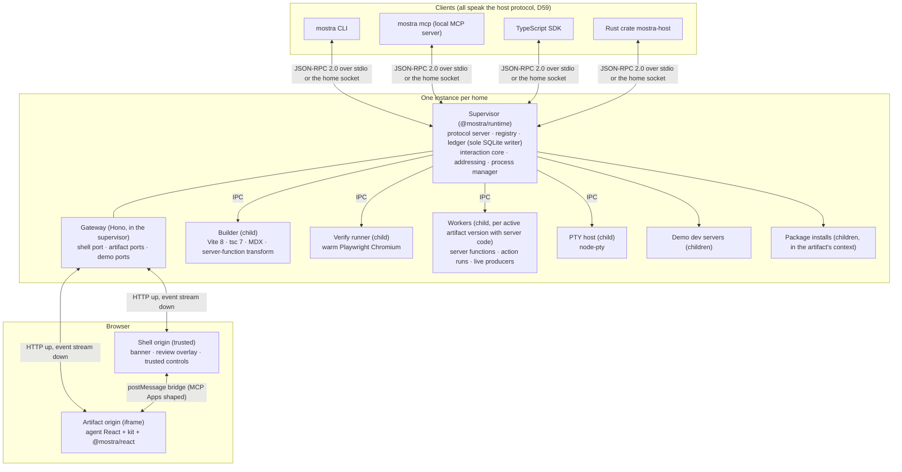
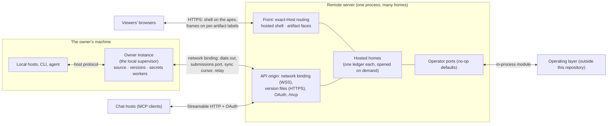

# Mostra architecture

**Status:** Settled architecture for v1, written by the C03-A phase design from the approved decisions in [DECISIONS.md](DECISIONS.md). It replaces the seed's architecture direction (commit `e1a5683`), whose approved content it keeps. Interfaces are specified in [INTERFACES.md](INTERFACES.md), stored data in [DATA_MODEL.md](DATA_MODEL.md), and failure, recovery and concurrency behavior in [FAILURE_MODEL.md](FAILURE_MODEL.md). Third-party facts are in [VERIFIED_FACTS.md](VERIFIED_FACTS.md). Every "Open for C03-A" question from the seed is resolved in [§16](#16-resolution-of-the-seeds-open-questions). The remote server, the relay and the operator boundary are [§15](#15-the-remote-server-the-relay-and-the-operator-boundary) (D165).

## 1. The shape in one page

Mostra has four kinds of caller:
- the **agent author**, who writes ordinary React (D04) and drives Mostra through the CLI, the local MCP server or an SDK;
- the **human viewer**, who uses a browser;
- the **host**, which embeds Mostra through the host protocol and ports;
- the **plugin author**, who implements extension contracts.

All four reach one **instance** per Mostra home (D45): a supervisor process with child processes it owns.

Load-bearing decisions:
- **The supervisor never runs artifact code** (RT-02). It parses manifests statically and delegates building, verifying, server code, PTYs and installs to child processes it supervises.
- **One owner per invariant.** The supervisor is the only writer of the ledger (D58, D71). Every transition that matters is one SQLite transaction: draft compare-and-set, submission creation, outbox enqueue, action-run state and event append.
- **Humans only see published, immutable versions** (D09). `mostra dev` is a separate developer path that never serves a capability URL.
- **Trusted controls render only in the shell origin** (D06, invariant 7). Artifact code can request them, never render or click them.
- **Hosts never touch storage or React.** They see domain objects through the protocol and optional ports (D58).

## 2. Artifacts

An artifact is ordinary React and TypeScript, or MDX (D04). The forms:
- a single `page.tsx` or `page.mdx` file, or a directory whose entry is `index.tsx` or `index.mdx`;
- an optional `pages/` folder for routing (D57);
- optional `"use server"` modules (D54) and `live.ts` live sources (D56);
- any components, data and assets.

No `package.json` is needed (AU-03). The manifest is a literal `defineArtifact({...})` in the entry, or frontmatter in MDX, and Mostra extracts it without running code (D51).

Persisted input is always a **field**, a value with an explicit, stable ID (D52):
- **viewer-scoped** by default: the viewer's draft (D39);
- **artifact-scoped** when declared: shared state that viewers, agents and hosts all write (D63).

Draft carry-over between versions, orphans (D42), conflicts and results are all defined per field ID.

An artifact's **submission policy** is requested by the manifest and decided by the host:
- `once` (scope `per-artifact` or `per-viewer`, D39);
- `epochs`;
- `none` (D63).

One-off artifacts (questionnaire, review, approval) and long-lived ones (a dashboard all week, a task manager) are two configurations of the same model, set mainly by policy and field scope (D63, D66).

Design is unbounded: the kit is a beautiful baseline, never a requirement (D68).

## 3. Versions, publishing and export

**Identity.** A version is identified by digests of its source tree and its environment (DATA_MODEL §2). Publishing the same source in the same environment twice yields the same version, so publish is idempotent. The output digest is recorded separately, and Mostra makes no claim of byte-identical rebuilds (VR-01).

**Publish** runs these steps, any of which can fail and leave no visible version (VR-02, D41):
1. Snapshot the source tree into staging.
2. Resolve and freeze dependencies into a lockfile (D20, D43, D95): the snapshot's imports, the warm set and the artifact's working lockfile, installing what the store lacks in an install child.
3. Compute the digests.
4. Reuse the cached `verify` verdict for those digests, or run `verify`. Error-severity diagnostics refuse the publish unless `--force`, which records the failing codes in the version manifest.
5. Promote the verified build output (built once, by `verify`) into the content-addressed version store with an immutable manifest.
6. In one ledger transaction, insert the version, bind the artifact, and append `version.published`.
7. Return the receipt: artifact ID, version ID, version number, capability URL and an event cursor (H-07).

**Viewing.** A capability URL opens the shell for a version. When a newer version exists, open views show the banner (VR-04). Draft fields carry over by ID, and unmatched fields stay as orphans that the viewer can see and that the submission includes (D42). A viewer can choose "Always follow this artifact" (D63), which loads new versions automatically unless that would leave unsaved edits or create orphans.

**Retention.** Versions are kept unless `mostra gc` removes them, and gc never removes a version referenced by a submission, view or review set (VR-06, D47). Build caches are LRU-capped at 5 GB.

**Export classes** (VR-07):

| Class | Contents | Server features |
|---|---|---|
| `static` | the client build as files, hash-routed (D57) | None. Fields keep local state and say they can't be submitted |
| `html` | one self-contained HTML file | Same as `static` |
| `bundle` | client build, server bundle, manifest and lockfile: the **portable artifact package** (RM-01) | Run anywhere with `mostra run <bundle>` |
| `snapshot` | what a view showed, including field values and live values at a cursor | Actions marked unavailable, never faked |
| `mcp-app` | single-file `ui://` resource with declared CSP and the bridge transport (D61) | Through the local MCP server, or the remote MCP server in cloud chat hosts (D116) |

## 4. Process model

**Instance per home** (D45). A home is a directory chosen by the host (`MOSTRA_HOME`, `--home`, or the SDK's `home`), defaulting to `~/.mostra` on macOS and `${XDG_DATA_HOME:-~/.local/share}/mostra` on Linux. One supervisor owns a home, enforced by an exclusive SQLite lock on the home's ledger, which the operating system releases when the process dies (D81).
- **Lock and socket.** The control socket is how clients find the owner, never the lock. It lives in a short per-user runtime directory (`MOSTRA_RUNTIME_DIR`, `$XDG_RUNTIME_DIR/mostra/<home-hash>.sock` when that directory is safe, or `~/.mostra/run/<home-hash>.sock` on macOS, D82), because macOS limits socket paths to 104 bytes (VERIFIED_FACTS, process model). The owner records its PID, start time and socket in `instance.json` in the home, and re-creates the socket if the file disappears.
- **Races and stale sockets.** A starter that can't take the lock reads `instance.json` and attaches to the recorded socket. The lock holder simply replaces a stale socket file (FAILURE_MODEL §2).

**Two ways to run** (RT-06, H-12):
- **Attached daemon.** `mostra daemon start` (or the first CLI command that needs it) starts a detached supervisor (`mostra-runtime daemon`, D85). Clients attach over the socket. It keeps running while it has open views, active shares, pending deliveries, running producers or attached clients, and otherwise exits after 30 idle minutes. `mostra daemon install` registers a launchd or systemd user service, or on Windows a Task Scheduler task at the user's logon (D151), for always-on artifacts (D62, D63).
- **Host-spawned.** `mostra host` (`mostra-runtime host` in the runtime bundle, D85) speaks the protocol over stdio and lives exactly as long as the connection. While it runs it also binds the home socket, so the CLI and MCP server inside that host's environment attach to the same instance (through `MOSTRA_HOME`).

**Children.** The supervisor's process manager starts, watches and reaps every child:
- builders;
- the verify runner;
- workers (one per active artifact version with server code; usually one per artifact);
- the PTY host;
- declared demo dev servers;
- package installs.

Each child runs in its own process group (on Windows its own Job Object, which ends it and its descendants the moment the supervisor dies, D150). Its PID and start time (creation time on Windows) are recorded in the ledger before it may run, so a restarted supervisor reaps leftovers from a crash (FAILURE_MODEL §2). Frozen client-only versions need no process at all; the gateway serves their files (RT-05).

**Windows** (D146, D150). One module of the runtime, `platform`, holds every difference between POSIX and Windows, and a small Rust helper, `mostra-win`, does what Node.js can't there: the home is `%LOCALAPPDATA%\mostra`, owner-only by a protected access list; the control endpoint is an owner-only named pipe the helper serves and forwards to the supervisor, with a fresh name on every bind that `instance.json` records; each child starts suspended behind the helper's gate in a kill-on-close Job Object, recorded by PID and creation time before it runs. An instance stops over the protocol (`mostra/shutdown`), since Windows has no signals between processes. Every client opens the pipe through the helper (`connectControl` in `@mostra/sdk`, D151) or, in the Rust crate, through its own owner check (D153), and the login service is a Task Scheduler task whose windowless launcher, `mostra-win-service`, keeps the daemon running (D151). Windows on x64 and arm64 is supported like macOS and Linux since WP-W3 (D153).

**Limits and lifecycles** are for stability, never security (D05, D62):
- **Workers:** 1 GiB heap and a 10 s event-loop watchdog by default, configurable per artifact. Evicted after 10 idle minutes. Restarted with exponential backoff after a crash, which is reported to the viewer and the event log (RT-04).
- **Verify runner:** keeps a warm Chromium and closes it after 10 idle minutes.

**Runtime distribution** (RT-01, RT-12, H-13, D142, D153). Each platform (macOS arm64 and x64, Linux x64 and arm64 with glibc, Windows x64 and arm64) gets one hash-pinned, attested bundle: a private Node LTS (24 now, 26 after its LTS date, D48), prebuilt Mostra code, the warm package set, pnpm 10 and native modules (better-sqlite3, Rolldown, Lightning CSS, Tailwind's oxide, TypeScript 7's compiler; node-pty with the terminals in v1.1), each listed with its SHA-256 in the bundle's `files.json`. The verify browser (Playwright's Chrome Headless Shell) isn't redistributed: setup fetches the revision the bundle pins with the bundle's own Playwright and checks every file against the pin (D142 item 2).
- `npm create mostra`, `@mostra/cli`, the SDK and the Rust crate download it, check its size and SHA-256 against the pins their release carries, check every file against `files.json`, and cache it by digest (D142 items 3, 4).
- Every entry point runs on the private runtime, so users never need a global Node; a CLI installed from npm only starts the bundle's own (D142 item 6).
- A Windows bundle (D153) carries `node/node.exe`, the helpers `mostra-win.exe` and `mostra-win-service.exe` and native launchers (`bin\mostra.exe`, `mostra-runtime.exe`, `mostra-setup.exe`); its archive holds no links, and setup makes the ones `files.json` lists as junctions at the bundle's real path, so an ordinary user installs it. Every other platform fails closed with `MOSTRA_PLATFORM_UNSUPPORTED` (D35).

## 5. The browser side

**Origins** (D21, D38, D70). The gateway listens on one port for the shell and on a stably leased port per opened artifact, all on the same loopback hostname. Shell and artifacts are therefore same-site but different origins.
- **Cookie mode.** A capability token in the launch URL is exchanged once for an origin-bound `HttpOnly; SameSite=Strict` session, and the token is stripped from the URL. The shell then hands the frame a single-use frame ticket, which the frame exchanges for its own session.
- **Worker mode.** Where shell and artifact are cross-site (Cloudflare quick tunnels in v1, a host's external bases on two host names), the frame session uses a service worker plus ticketed streams instead: a bootstrap page exchanges the shell's ticket for a frame-session secret, installs Mostra's worker at `/`, which signs every same-origin request with it, and event streams, polls and WebSockets bypass the worker with single-use tickets (D70, D158 item 5).
- **Faces.** Every external address (a tailnet, Funnel or Cloudflare address, a host's external base) is a face: a listener of its own on loopback with one origin, one exact `Host`, one way in and one frame-session mode, serving the shell's routes or one artifact's. Which face a request came through is the socket it arrived on, never a header (D158 item 1).
- The addressing module picks the mode per origin pair. Artifact code never sees the difference.

**The shell** is a small trusted web app (`@mostra/shell`) on the shell origin. It owns:
- the artifact iframe;
- the version banner and the follow choice;
- the review overlay (pins, threads, review-set layouts);
- the submit, choose and approve trusted controls;
- the viewer chip;
- the save and delivery states (D47).

Its look is quiet by design, so the artifact is the work on show (D68). A host may theme it, or replace it by implementing the same bridge (D65).

**The client runtime** (`@mostra/react`) is compiled into every version. It provides fields, actions, live data, signals and `window.storage`, talks to the gateway over the **browser protocol** (INTERFACES §4), and talks to the shell over the bridge (INTERFACES §5). Published versions are immutable, so an old version's runtime keeps talking to newer gateways. The browser protocol is therefore a dated, additive protocol of its own.

**Transport** (D22, D47):
- Commands go up as authenticated JSON POSTs.
- One resumable event stream per view comes down, as SSE with a cursor, falling back to long-polling on the same cursor where SSE fails.
- WebSockets are used only for terminals.
- Offline edits go to an IndexedDB journal that replays in order on reconnect.
- BroadcastChannel only cuts latency between same-browser tabs. It is never a source of truth.

## 6. Interaction core

The supervisor's interaction module owns drafts, artifact state, submissions, signals, reviews, action-run bookkeeping, events and the outbox. Data shapes are in DATA_MODEL; behavior under failure and concurrency is in FAILURE_MODEL.

**Fields and documents.** A draft is the viewer-scoped document for (artifact, viewer). Artifact state is the artifact-scoped document. Both are maps from field ID to value with a per-field revision, under a monotonically increasing document revision.
- **Mutations** carry a client-generated mutation ID, the base revision and the viewed version.
- **Concurrency.** Non-overlapping field edits rebase automatically. A field edited elsewhere since the mutation's base becomes a conflict, returned to the writer with what the field holds now and shown in the field's `meta`; the rest of the mutation applies under one new revision (D106).
- **Idempotency.** Mutation IDs replay their recorded result; the same ID with other contents is refused (D106).
- **Views and viewers** (D104). Each frame load is a view of one exact version by one viewer: the home's local user, or the viewer a link was minted for. Mutations and submits name the view.

**Submit** is one transaction (IN-05):
1. Resolve the view to its exact version.
2. Check the policy in force (D102: `none` refuses; `once` checks uniqueness for its scope; `epochs` links to the viewer's previous submission, D103).
3. Check the expected draft revision.
4. Read the canonical persisted draft, plus artifact state at its current revision.
5. Compute the snapshot digest.
6. Insert the immutable submission with its channel, viewer and stale-view flag.
7. Enqueue one outbox delivery per host registered or expected for the submissions port, or one for the built-in adapter (D105).
8. Append `submission.created` and the `submit` signal (D106).

A duplicate submit returns the existing submission (D22). A second submit under `once` returns a typed conflict carrying the existing submission (H-02). A submission is durable before any delivery attempt (IN-12, invariant 6).

**Delivery and the outbox** (IN-12, H-04):
- The dispatcher delivers each submission to each host's submissions port in submission order, one at a time per host, idempotently by delivery ID (D105).
- Results: `accepted`, `rejected` (with a reason) or a transport failure. Failures retry with backoff, indefinitely while the host is registered as expecting deliveries.
- A host's rejection with reason `undeliverable` is terminal, and the viewer sees it.

The viewer sees `Submitted` (durable in Mostra), then `Delivered` or `Pending delivery`, or `Undeliverable` (IN-13, D47).

**Events** (IN-08). Every durable change appends an event, with a home-wide monotonic cursor and a per-artifact sequence. Hosts subscribe with a filter and a cursor and receive events in cursor order, without gaps across reconnects and restarts. Ephemeral traffic is never stored: presence, live updates (D63), action progress ticks and terminal output.

**Signals** (IN-09) are events with type `signal.raised`, raised by artifact code (`useSignal`), by server code (`signal()`), or by the shell for submit. Mostra never decides what wakes an agent. Hosts filter.

**Wait and results** (IN-10, IN-11):
- `wait` blocks until a condition holds or the timeout passes. Its conditions are `submitted`, `signal:<name>`, `state:<field>` and `event:<type>`.
- `submitted` is level-triggered under `once` (any existing submission satisfies it; under `per-viewer` only while no cursor is given, D107) and edge-triggered under `epochs`; it is refused under `none` (D103). The others are edge-triggered after a cursor, defaulting to the cursor of the artifact's latest publish.
- On timeout it returns `still_waiting` with a cursor and loses nothing.
- `results` assembles the complete submission (INTERFACES §8) as JSON and as Markdown for agents.

## 7. Server code: actions, live data, state

**Workers** (`@mostra/worker`) load a version's server bundle and execute:
- server functions;
- action runs;
- live producers.

The gateway (Hono) authenticates the browser request, then forwards a typed call over IPC with the request context (viewer, view, version, run). The worker runs it inside AsyncLocalStorage (D19 seam 3). Workers never see cookies, tokens or raw browser requests.

**Plain calls and action runs** (D54):
- A direct call is a plain RPC.
- `useAction` creates an `ActionRun`, recorded by the supervisor before the worker starts it. A run moves through `queued`, `running` and a final state (`succeeded`, `failed` or `cancelled`), with progress, log (capped at 1 MB, D47) and partial results streamed to the page.
- Runs outlive the tab and re-attach. Explicit keys are unique per (artifact, action, key), so a duplicate invocation joins the existing run (AC-03).
- Cancellation reaches the action as an `AbortSignal` (AC-04).
- A run cut off by a worker crash ends `failed` with reason `interrupted`. Mostra never retries it implicitly (D24).

**Live sources** (D56, D63):
- **Producers** run in the worker of the latest published version that defines them, while a view or host subscription exists, or always with `always: true`. Pushes from the CLI, SDK or protocol write the same sources.
- **Storage.** The latest value persists with a revision, and an optional ring buffer keeps the high-rate window (AC-08).
- **Delivery.** Updates go out as ephemeral stream notifications, and a reconnecting view receives the latest value.

**Artifact state from the server.** `state` in `@mostra/server` and `mostra state` in the CLI write the artifact-scoped document through the same compare-and-set path as viewers (D63). A task-manager action that adds a task is one state mutation with its own mutation ID.

**Secrets** (D44) are resolved by name through the secrets port, defaulting to the home's 0600 store. Values reach server code only through `secret()`. Mostra redacts them from logs, diagnostics, events, exports and screenshots.

## 8. Review

Review lives in the shell's overlay (D23). Comments anchor with every applicable layer:
- the semantic `data-review-id`;
- W3C selectors (CSS and text quote);
- frame-relative coordinates with viewport and DPR;
- a screenshot crop, which is always stored.

The crop comes from the capture port. The default captures through the verify runner's browser at the view's version, viewport and field values, plus the viewer's own rendered pixels where the bridge can supply them.

Special anchors:
- kit charts map clicks to series and datum;
- terminals use cell rectangles plus recording time;
- timelines and video use time plus region;
- slides use slide and step.

Frames Mostra serves (including proxied demos, D65) get the injected bridge, so their content anchors semantically. Opaque frames fall back to coordinates and crops.

Threads have replies, resolve and reopen, and record each message's author (D47). Review sets lay candidates out as gallery, focus or synchronized compare. Choose is a trusted control whose result is the field `review.<set>.choice` (D65). `mostra review export` writes Markdown and JSON with crop paths (RV-05).

## 9. Terminals and web demos

One frame model (cells, styles, cursor, size, timing, width table) underlies all four terminal modes (D28, D65), which ship in v1.1, after the first release (D122); web demos, below, are v1:
- **Recorded:** asciicast v3 bytes replayed through `@xterm/headless` with Unicode 11 widths into frames, drawn by Mostra's `<TerminalGrid>` with a bundled font and procedural box drawing.
- **Captured:** ratatui buffers from the `mostra-term-capture` crate, with widths taken from ratatui.
- **WASM:** a Ratzilla iframe island that reports frames over the bridge.
- **Live:** a declared PTY session from the PTY host, rendered by xterm.js 6 with WebGL behind the embed-engine contract, and teed into an asciicast v3 recording.

`mostra term dump` and terminal lint give agents text, cells and ANSI output without vision (TM-06).

Web demos are declared in the manifest. The gateway proxies each one on its own leased port origin, with HTTP and WebSocket passthrough, header rewriting where needed, framing headers stripped from that demo's responses only, and the bridge injected unless turned off (TM-08). The kit's `<WebDemo>` adds device frames and viewport switching.

## 10. Hygiene and remote viewing

The 13-point checklist (seed §11, D06) is implemented in the gateway and the MCP HTTP transport, and verified by negative tests (HY-01):
- loopback bind by default; wider binds need an explicit flag (HY-02);
- an exact Host allowlist, including registered tunnel hostnames only;
- exact Origin checks on every non-GET request, stream and WebSocket upgrade;
- capability tokens of at least 128 bits, exchanged for sessions and stripped from URLs;
- CSRF tokens plus JSON content types on mutations;
- no permissive CORS, `Cross-Origin-Resource-Policy: same-origin`, `Referrer-Policy: no-referrer`;
- per-scope tokens (`view`, `draft`, `submit`, `action:<name>`, `review`) that expire, rotate and revoke (410 when revoked), with rate-limited guessing (HY-03);
- capability URLs redacted everywhere;
- side-effect-free GETs; robust header parsing.

The gateway strips Mostra's cookies before proxying to workers, demos or terminals (D38). Local capability URLs don't expire by default (D63).

**Sharing** (D47, D158, HY-04, HY-05) drives the installed tools, each as a recorded child of the process manager, and opens a face for each address they give, which is how a tunnel hostname joins the exact Host allowlist:
- `mostra share --tailnet` uses Tailscale Serve and maps the identity headers to viewers. The backend stays on loopback so the headers can't be spoofed.
- `mostra share --public` uses Tailscale Funnel (ports 443, 8443 and 10000: the shell plus up to two artifacts) or a Cloudflare quick tunnel (worker-mode frames, D70). Public shares always use short-lived scoped tokens.
- The event stream falls back to long-polling where SSE doesn't pass. Cloudflare quick tunnels hold a whole response back (VERIFIED_FACTS, WP-13), so the gateway refuses streams there and pages poll from the start; every stream opens with `ready`, so a page that hears nothing polls anyway.
- A share mints its own link at its tunnel's shell address, ends at its TTL (public: 1 hour by default, 7 days at most), on `share/stop`, or when its tunnel can't continue, and tailnet and Funnel shares are set up again after a restart. Active shares keep a daemon from its idle exit.
- A host's `addressing` port (HO-10) gives its own tunnel's address for an artifact's links in the same way: each answer becomes a face on a leased loopback port the host forwards to.
- When a tool is missing, Mostra explains how to install it.
- **A remote server** (D116) is the last rung: the agent shares a published version to a self-hostable remote server, or to the managed service that runs the same open server, and the link works without a tunnel and while the author's machine sleeps. Hosted artifacts are served only from a separate user-content domain, behind the same capability URLs and scopes (D06, D97). Their action calls and live producers run on the owner's instance through the relay (D117). [§15](#15-the-remote-server-the-relay-and-the-operator-boundary) is the design (D165).

## 11. Host integration

Hosts integrate through the **host protocol** (D59, INTERFACES §6) and **optional ports** (D58, INTERFACES §7). Every port has a standalone default, so a host that registers none behaves like the CLI:

| Port | Standalone default | Jcode's expected use (C03-B, JCODE_HOST) |
|---|---|---|
| `identity` | single local user; Tailscale header mapping | map its tunnel identity (H-05, H-14) |
| `submissions` | accept immediately | deliver into `session_work_v1`; `rejected: undeliverable` for gone sessions (H-01 to H-04) |
| `drafts`, `reviews` | none | optional opaque mirrors |
| `events` | read by `wait` and `results` | subscribe to `submission.created` only (H-09) |
| `addressing` | loopback ports, tailnet and public shares | publish tunnel hostnames (H-14) |
| `trustedControls` | shell renders submit and choose; both channels allowed | shell-only submit (H-05) |
| `capture` | verify runner's browser | default |
| `secrets` | home store | its credential store |
| `pty` | PTY host | default or its own PTYs |

**Operator ports** (D116, HO-09) are the remote server's counterpart for whoever operates it: limits, metering, account resolution and abuse actions, each with a no-op default, so a self-hoster needs nothing more. The managed service's operating layer, which lives outside this repository (D118), reaches the remote server only through them, as hosts reach an instance only through the host protocol and its ports (invariant 11). Their shape is [§15.10](#1510-the-operator-boundary) (D165).

The **Rust crate** `mostra-host` has wire types generated from the schema, a hand-written tokio client, spawn and attach, runtime-bundle download and cache, and port traits (HO-03). The **TypeScript SDK** has `createMostra({ home, ports })` (HO-04). The **conformance kit** (HO-05) runs scenarios against a host through a harness shim the host ships, with expected-failure baselines, and the TypeScript and Rust reference hosts pass it (D143, INTERFACES §17). JCODE_HOST's H-01 to H-16 map to generic mechanisms only (HO-06, [JCODE_HOST.md](JCODE_HOST.md#how-mostra-meets-each-need)).

## 12. Agent experience

- **`verify`** (D29, D65): type-check and build; lint, including wrong-base idioms, churned APIs and field IDs; boot; render in the warm browser; collect errors, console, network and React boundaries; axe and an ARIA snapshot; screenshots at 1280×800 and 390×844, DPR 1, with token estimates; the smoke test (actions only through `dryRun()`, D55; observations without a runtime error are warnings, D72); regressions against the last passing version; one JSON verdict with stable `MOSTRA_<AREA>_<NAME>` codes.
- **The CLI** (D60) is a thin protocol client with `--json` everywhere, documented exit codes and no prompts outside a TTY.
- **The local MCP server** (D61) is a stateless protocol client with about twelve `artifact_`-prefixed tools. Its tool handlers don't depend on the transport, so the remote MCP server (D116, WP-30) serves the same tools over Streamable HTTP with OAuth.
- **Documentation for agents:** the Skill (trigger D69), AGENTS.md in the repository and every scaffolded artifact, templates per family (including long-lived ones), a gallery with source and result, generated `llms.txt`, and harness plugins generated from one source (D65).

## 13. Extensibility

Six contract packages at 0.x (D65): embed engine, exporter, verify check, anchor provider, connector, CLI command. Plugins declare them under the `"mostra"` key in `package.json`, with declared (never enforced) effects and license metadata. The non-OSI license acknowledgment is recorded in the lockfile (D31). Packs are shadcn registry items with an optional `mostra` block. The `RenderMode` contract stays internal, with SPA as its only v1 implementation (D19 seam 5). First-party plugins prove the contracts:
- the MCP App exporter;
- the Remotion and GSAP adapters (user-installed, license flow);
- chart datum anchors;
- a filesystem connector;
- with the terminal packages in v1.1 (D122): the xterm.js engine and `mostra term record`.

## 14. Render modes and remote readiness

**Render modes** (D19). SPA is permanent and first-class (RS-02). The five v1 seams make RSC additive (RS-01):
1. the manifest's `mode` (default `spa`);
2. `"use server"` functions with React's serializable type set (D54);
3. AsyncLocalStorage request context in workers;
4. a client runtime whose modules carry `"use client"`, with no environment-assuming singletons and client-only bridge access;
5. the internal `RenderMode` contract (INTERFACES §11).

A later `rsc` mode adds rsc, ssr and client builder environments (`@vitejs/plugin-rsc`), a Flight handler in the worker behind capability authentication, prerender-only MCP App export and server-render error capture in `verify`. Versions, submissions, review, the host protocol, the gateway and `verify`'s browser stages stay unchanged. Old versions never migrate; an artifact opts in with a new version.

**Remote readiness** (D12, RM-01). v1 builds the seams that the remote server uses:
- the portable `bundle` export (§3);
- identity, addressing and every other port (D58);
- worker mode for cross-site frames (D70);
- the `WorkerLauncher` interface that becomes `SandboxPort`, taking a version reference rather than a directory (INTERFACES §7, D124);
- a stateless MCP server with explicit handles (D61).

**The remote server** is in v1 (D116): a remote transport for the host protocol, the relay (D117), many homes behind one gateway on a separate user-content domain, viewer sign-in, operator ports (§11) and a remote MCP server over Streamable HTTP with OAuth. Its design is [§15](#15-the-remote-server-the-relay-and-the-operator-boundary) (D165). Sandboxed remote execution through `SandboxPort` stays v1.x (RM-06).

**Layers stay usable on their own** (D01, D30): the kit without the runtime, the runtime with any components, and any host through the ports.

## 15. The remote server, the relay and the operator boundary

The remote server (D116) gives a shared link that works without a tunnel and while the author's machine sleeps, and gives cloud chat hosts a remote MCP server. Its design is D165; interfaces are INTERFACES §18, stored data DATA_MODEL §7, failure behavior FAILURE_MODEL §11. Domains below are examples (`usercontent.example` for a user-content domain, `api.example` for an API origin).

### 15.1 The shape

- **The owner instance** is an ordinary local Mostra instance that shares artifacts to a server. It stays canonical for source, versions, secrets and server code, and it runs every relayed run, call, live producer and authoring operation.
- **The remote server** is one process holding many **hosted homes**. Each hosted home is a Mostra home without builds, verify, workers or secrets: its ledger, interaction core, events, outbox, links and gateway routes are the same modules the local runtime has (§6, §10), serving an account's hosted artifacts. It runs no artifact code (D117).
- **The operating layer** of a managed service reaches the server only through operator ports (§15.10), as hosts reach an instance only through the host protocol (invariant 11).

### 15.2 Hosted homes

- **Canonical data** (D165 item 1). A hosted home is canonical for everything viewers of its hosted links create: drafts, artifact state, submissions, comments, action runs, live values, links and views.
- **One owner per home.** A hosted home belongs to one owner, an account, and later an organization (WP-31 and the operating layer), and holds every artifact that owner hosts on the server, whichever of its linked instances shared it (§15.3).
- **One writer per home** (D165 item 0b). A hosted ledger opens in WAL with normal locking and `synchronous=FULL`, so a backup replicator may read it. Its one writer is the process that holds the home's advisory lock (released by the operating system when the process dies), together with the server's in-process registry of open homes. A data directory on a network filesystem is refused.
- **Opened on demand** (D165 item 6). A home opens on its first request (under 250 ms at the 95th percentile) and closes after 10 idle minutes: no connection, stream, poll, pending delivery or waiting run. Several server processes can serve several data directories; which one serves a home is the operator's routing.
- **What a hosted home lacks:** sources, builds, verify, the dependency store, workers, secrets and terminals. Versions arrive from the owner (§15.4), and server code runs on the owner (§15.5).

### 15.3 The owner's link

- **The network binding** (D165 item 2) is the host protocol as JSON-RPC 2.0 over WebSocket on the API origin, with the methods, revisions and diagnostics of stdio and the socket. The owner instance dials out and keeps one connection per linked server, with heartbeats every 20 s each way, a 45 s silence limit, and reconnection with backoff. Messages are at most the protocol's line limit, and bulk bytes go over HTTPS.
- **Sign-in.** `mostra login` runs the OAuth device authorization grant against the server's authorization server; the instance keeps its refresh token in the home, owner-only, and each linked instance is a revocable grant of its own.
- **The owner instance is a host of its hosted home** (D165 item 1):
  - it registers the `submissions` port and is an expected owner, so the hosted outbox delivers each submission to it in order, idempotently, waiting while it is away; it stores the submission (same IDs and digest) and enqueues its own outbox to its local hosts in one transaction, so local hosts receive hosted submissions through the local outbox (RM-02);
  - a named event subscription on the hosted home is the sync cursor: the instance copies its hosted artifacts' durable events into its own log, so `wait`, `results` and `events` work locally unchanged;
  - it registers the `relay` port (§15.5).
- **One copy of shared state.** A hosted artifact's artifact state and live values live in the hosted home. Writes from the owner's side go there, refused with a code when it can't be reached, never applied locally alone. The owner's own local links keep their drafts and submissions locally, as a separate audience.
- **One owner instance per hosted artifact** (D165 item 1b): the instance that shared it receives its deliveries, relayed runs and authoring calls. Other instances of the account read and wait through the hosted home. Chat-host authoring goes to the account's default instance, the first one linked unless changed.

### 15.4 Sharing and versions

`mostra share <artifact> --cloud [<server>]` (D165 item 15) pushes the latest version and mints a hosted link:
- **What is pushed** (D165 item 3): the client build, `manifest.json`, `registry.json`, `lock.yaml` and the full output listing (every built file's path and SHA-256, server files included). The server checks the client files against `outputDigest` without receiving server code. Files go to content-addressed URLs on the API origin, only those the server lacks. Never sources.
- **Identity.** The version keeps its ID (D89) and number, so a submission names the same version in both homes.
- **Later publishes follow.** While an artifact is shared, each publish of it is pushed too, queued while the server can't be reached. Hosted viewers see the version banner as local ones do (VR-04).
- **Links** are the hosted home's own capability links (D97), minted at the share's hosted address, with scopes, expiry and a viewer as locally.

### 15.5 The relay

The relay (D117, D165 item 4) runs a hosted artifact's server code on its owner instance, over the owner's binding connection:
- **Runs.** The hosted home records each run as a local instance does (`queued`, D130), then sends it to the owner instance, which records it under the hosted run's ID, runs it in its own worker pool with its own watchdog and secrets, and streams progress, log, result batches and its end back. A repeated relay message joins the recorded run, so a run happens at most once across both homes.
- **Plain calls** are relayed while the owner is connected, and answer "owner offline" at once otherwise, since they aren't durable.
- **Owner offline.** A run waits in `waiting`, and the page says it waits for the owner. The artifact's offline policy (manifest `hosted.offline`) is `queue` with a time limit (24 hours by default, 7 days at most) or `fail`. Waiting runs per artifact are capped (a server setting and a limits operation): past the cap a run is refused before it is recorded. When the owner returns, waiting runs start in the order they were made, at a bounded rate.
- **Relay lost mid-run.** The owner finishes the run and reports its end when it reconnects. Until then the hosted home shows the run running with its owner unreachable. Once the offline limit passes, a run with no reported end becomes `unknown` (outcome unknown), never `failed`: waits and pages stop treating it as running, and the owner's later report replaces it once, with both events kept.
- **Live producers** run on the owner while there is interest (a viewer, or `always`) and push their values to the hosted home, which keeps the latest value and the ring and serves them to viewers. While the owner is offline, viewers see the last value with its time and an "owner offline" flag.
- **Server code's other effects** (`state`, `signal`, `emit`) are sent to the hosted home with the run's causation. `secret()` is answered on the owner instance, and no secret ever crosses the relay.
- **Who may trigger** (D159): on hosted links, relayed runs and calls need a signed-in viewer or an expected respondent unless the manifest opts into "anyone with the link"; a rate limit applies per link.
- **Authoring** (D165 item 5): remote MCP's authoring tools (create, write, patch, verify, publish) are relayed to the owner instance's workspace, builder and `verify`; a publish through them also hosts the version.

### 15.6 Addressing and the hosted shell

- **Origins** (D165 item 7). Each hosted artifact is served from `https://<label>.usercontent.example`, one DNS label derived from its artifact ID, so one wildcard certificate covers every artifact. The hosted shell lives on the apex, `https://usercontent.example/a/<artifactId>[/v/<number>]#t=<secret>`. Hosted frames always use worker mode (D70), so nothing depends on the shell and its frames being cross-site.
- **Rules of the hosted shell:**
  - the apex serves only the shell, never an artifact's files;
  - every hosted response sends `Origin-Agent-Cluster: ?1`, and the shell never sets `document.domain`;
  - no credential is ever bound to the user-content domain: no passwords and no WebAuthn whose relying-party ID is the domain or a name under it; sign-in happens only on the API origin;
  - the shell's resources send `Cross-Origin-Resource-Policy: same-origin`, and no check treats `Sec-Fetch-Site: same-site` as trust;
  - the shell's framing policy is an operator setting whose only v1 value is `frame-ancestors 'none'` (D145);
  - the trusted chrome of D161 and the report control render in the shell, never in the artifact (invariant 7).
- **Domains** (D137). The active user-content domain and its spares are configuration. Each link records the domain it was minted on and keeps working there, and new links use the active one, so a domain move needs no release.
- **Hostnames an operator supplies.** Through the operator port `routing.resolve(host)`, an operator can serve an artifact, or all of an account's links, on a hostname it supplies: a chosen label, or an organization's own domain whose TLS the operator's edge terminates. A page there keeps its own origin, worker-mode frames and no cookies; an unknown `Host` gets nothing.
- **The API origin** (`api.example`) carries the network binding, version files, the OAuth authorization server and `/mcp`. It is never on the user-content domain.
- **TLS** is terminated in front of the server (an edge, or Caddy for a self-hoster). The server routes by the exact `Host` and believes forwarded headers only from configured proxies.

### 15.7 Identity and sessions

- **No cookies on hosted origins** (D165 item 8). The hosted shell keeps its session secret in its own origin's storage and sends it in a header; frames send `X-Mostra-Frame` (D158 item 5); the server ignores and drops every `Cookie` header on hosted hosts. A tenant page can therefore neither plant, overwrite, shadow nor crowd out another origin's session, with or without a public-suffix entry. Exact Host and Origin checks, CSRF tokens, scopes and origin-bound sessions are D98's, unchanged.
- **Sign-in** happens only on the API origin, through the server's OAuth 2.1 authorization server, whose identity providers sit behind a port: an operator configures GitHub, Google, any OpenID Connect provider or its own, and a self-hoster its own or none. An account is separate from its sign-in identities. The same authorization server issues the CLI's device-grant tokens, MCP clients' tokens and viewers' sign-in. Enterprise identity (SAML, SCIM) plugs into the same port from `ee/` or an operator.
- **Viewers.** A hosted link minted with a viewer acts as that viewer (D104). One minted without a viewer acts as the signed-in person's account (viewer kind `account`, its name verified by its provider), or, for a person not signed in, as an anonymous viewer per browser (kind `anonymous`, an optional self-chosen name recorded unverified). The capability URL stays the authorization (D06, D97); sign-in only names the person.

### 15.8 What a respondent meets

- **After Submit** the shell says "Your answer was sent." (D161) as soon as the hosted home commits the submission, and nothing about delivery. Delivery states are shown to the owner, the owner's agent and hosts, and in the shell only when the signed-in viewer is the owner (D165 item 1a, amending IN-13 for hosted links).
- **The trusted chrome** (D161): the sender line, "Never enter passwords", generic link previews, `noindex`, and the report control.
- **Anonymous answers at volume** (D165 item 13): hosted links accept submissions from viewers who aren't signed in when the artifact's policy allows it, at about 1 a second sustained and 10 a second in bursts per artifact, accepted under 0.5 s at the 95th percentile with the owner offline. Per-IP and per-link limits are server settings; past them the shell says "try again shortly" and keeps the draft.
- **Counts by choice** (D165 item 12): an artifact that opts in through its manifest gets a built-in tally of a fixed-choice field, counted in the submit transaction and pushed to viewers on the live channel, with no artifact code and no relay. The same works locally.
- **Pause** (D165 item 14): a paused artifact stays viewable and shows that it is paused; it takes no submissions and runs no relayed actions until resumed.

### 15.9 Remote MCP

The remote MCP server (D116, MC-04, D165 item 10) serves `@mostra/mcp`'s factory (D164) at `https://api.example/mcp` over Streamable HTTP, statelessly, for the `2026-07-28` revision and the 2025 revisions. OAuth follows that revision's authorization specification (Client ID Metadata Documents and Dynamic Client Registration, PKCE, resource indicators, `iss`, rotating refresh tokens). Its ports:
- **the instance:** reading tools act on the account's hosted home; authoring tools are relayed to the account's default owner instance, and without one connected they answer `MOSTRA_REMOTE_NO_INSTANCE`;
- **the workspace** is the owner instance's own, reached through the relay;
- **the docs** are bundled.

The tools and their schemas are the local server's (D32). How a page renders and what a quota message may say inside a chat host is a policy per host (D160).

### 15.10 The operator boundary

**The open server is complete for one operator serving its own people's homes** (D165 item 11): hosting, the relay, sign-in through providers it configures, remote MCP, the tally, rate limits and pause. Everything an operating layer adds comes through **operator ports**: TypeScript interfaces in a module the server loads in process, each call async and time-limited, each with a no-op default (D165 item 9):

| Port | What it does | No-op default |
|---|---|---|
| `limits` | Allows or refuses an operation (share, version push, link, view, submit, relayed call or run, waiting run, MCP call, storage) for an account | allow |
| `metering` | Receives counters in batches, at least once, with idempotency keys (views with a monthly pseudonymous viewer key, submissions, requests, bytes, relay messages, MCP calls by client, active seconds) | discard |
| `accounts` | Resolves a sign-in identity to an account (or a first sign-in step on the operator's origin); authenticates credentials the operator issued | the server's own accounts; no outside credential |
| `abuse` | Receives reports and a hook after each version push (with read access to its client files); acts through the server handle: quarantine, pause, suspend, revoke links, and deletion as a separate call | nothing |
| `policy` | Per link and artifact: interstitial, longest link lifetime, after-submit line, footer wording, the made-with mark | none of them |
| `routing` | Resolves an exact `Host` to the shell, a home and an artifact | the derived label |
| `events` | Receives submission accepted, version pushed, run ended, roster complete (WP-31), at least once with stable IDs | discard |

When `limits` doesn't answer in time, operations that create fail closed and viewer input proceeds, so nothing a person typed is lost.

**Not in the open server:** plans, entitlements and organization administration; quotas, cost and billing; abuse scoring, scanning and takedown tooling; placing homes across machines, backup and restore automation, and moving domains; service keys, webhooks and outside domains' provisioning; sending email; sandboxed execution (v1.x, `SandboxPort`). Enterprise identity and administration belong to `ee/` (D118).

### 15.11 Self-hosting

One multi-architecture Linux container image (D165 item 11) runs `mostra-runtime server` as a non-root user with one data volume (hosted homes, version files, the server's directory and keys) and configuration from environment variables or a file: the user-content domains, the API origin, identity providers, trusted proxies, rate limits and an optional operator module. A TLS terminator with a wildcard certificate sits in front (the docs show Caddy). One small machine serves a public anonymous page at §15.8's targets.

## 16. Resolution of the seed's open questions

| Seed section | Question | Resolution |
|---|---|---|
| §2 | Manifest form; field identity; routing | D51; D52; D57 |
| §3 | Retention and GC; publish and verify; banner with unmappable fields | D47; D41; D42 and D63 (follow) |
| §4 | Instance model; eviction, restart, limits; home location and override | D45, §4; D62; §4 and HO-08 |
| §5 | Serialization set; `*.server.ts`; `RenderMode` methods | D54; D54 (no); D65 (ROUND-3 §7), INTERFACES §11 |
| §6 | Auto-install or explicit add; kit declaration; import-map mode | D43; D65 (ROUND-3 §1.1); D47 (v1.x) |
| §7 | Draft scope; event retention; client runtime API; programmatic submit; outbox semantics; `window.storage` | D39; D47; D52, INTERFACES §2; D40; §6, FAILURE_MODEL §4; D53 |
| §8 | Secrets; dry-run; action-run retention | D44; D55; D47 |
| §9 | Threading; bridge in foreign apps; review export format | D47; D65 (on by default); INTERFACES §8 |
| §10 | Shell visual design; bridge message set; replaceable shell | D68 (direction accepted; final pass in its WP); D65, INTERFACES §5; D65 |
| §11 | Share commands and hostname registration; drive tools or print instructions | D60, §10; D47 (drive, explain when missing); D70 for cross-site tunnels |
| §12 | Extra transports; schema source; versioning; mandatory ports; AI port | D59 (stdio and Unix socket); D59 (Zod 4); D59 (dated revisions); D58 (all optional); D46 (out of v1, name reserved) |
| §13 | Default base; final kit list; questionnaire; maps and 3D; deck grammar; composition primitive | D72 (Base UI, EVAL-01); D65, D72 and VERIFIED_FACTS; D65; D65 (on demand); D65; D65 |
| §14 | PTY implementation; headless emulator; frame schema; ghostty-web | D65 (node-pty in a PTY host behind the `pty` port); D65 (`@xterm/headless`, Unicode 11); D65, INTERFACES §10; watch list behind the embed-engine contract |
| §15 | Command set; diagnostics catalog; smoke scope; regression baseline; viewports; warm browser; Skill structure; harness plugins | D60; D65 (scheme), catalog grown per WP; D65; D65; D65; D65; D69 and ROUND-4; D65 |
| §16 | Tool list; MCP Apps storage; per-host conformance; further interop | D61; D61; D65; D47 (v1.x) |
| §17 | Contract list; manifest schema; pack format; first-party plugins; loading order | D65 |
| §18 | v1 remote seams | §3 (portable bundle), D58 (ports), INTERFACES §7 (`WorkerLauncher` becomes `SandboxPort`), D61 (stateless MCP) |
| §19 | Package map | D65 (P2), [REPO_STANDARDS.md](REPO_STANDARDS.md#3-packages) |
| extra | D33 confirmation; Windows; publication authorization; evaluation budget | D34; D35 (Windows in v1.0 since D146, built by WP-W1 to WP-W3, D150, D151, D153); D36, D67; D34, D64 |
