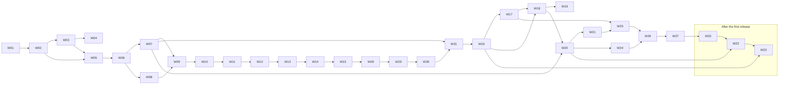

# Mostra work packages

**Status:** Accepted (D73, [DESIGN_ACCEPTANCE.md](DESIGN_ACCEPTANCE.md)); the plan update of 2026-10-16 (D116 to D127) added WP-28 to WP-32 and the order below, and D146 (2026-10-22) replaced WP-32 with the Windows packages WP-W1 to WP-W3, built before WP-13. Each package's full specification is [work-packages/WP-NN.md](work-packages/), generated from this file by `tools/design/wp_specs.py`, and every session follows [work-packages/README.md](work-packages/README.md). Edit this summary or the generator, then regenerate.

## How the sequence was built

- **Scope.** 34 packages: 32 deliver all of v1 (D16, as amended by D116, D121, D122 and D146) without shrinking it, and the 2 under [After the first release](#after-the-first-release) deliver the `v1.1` follow-up (D122). Every v1 and v1.1 requirement has exactly one primary owner here, and [EVIDENCE_MATRIX.md](EVIDENCE_MATRIX.md) checks it. Other packages may *contribute* to a requirement (for example, adding a lint rule to `verify`), but only the owner closes it with evidence.
- **Order.** Packages run in the order of this file (D125, D146): WP-01 to WP-12, then WP-W1 to WP-W3, then WP-13 to WP-15, then WP-28 to WP-31, then WP-16 to WP-21, WP-24, WP-25, WP-26 and WP-27; after the first release, WP-22 and WP-23. The numbers are identities, not positions: new packages took the next free numbers (D125), and the Windows packages carry their own W series (D146). The Windows packages follow the Rust crate and conformance kit, so every package after them is built and checked on macOS, Linux and Windows from its start. D17's interface priority explains the first part: the CLI, Skill and `verify` with the host protocol and Rust crate (WP-01 to WP-14, which together also give Jcode everything C03-B needs), then the local MCP server (WP-15). The remote server comes next (WP-28 to WP-30), because MCP Apps export (WP-17) persists through it in cloud chat hosts, and the team package (WP-31) needs its viewer identity. The remaining v1 features follow in dependency order. Two packages sit earlier than D17 alone would put them, because a prioritized interface depends on them:
  - WP-08 (actions) comes before `verify`, whose smoke test exercises action dry-runs;
  - WP-16 (extension contracts) comes before MCP Apps export, which ships as the first-party exporter plugin.
- **Specification depth.** From WP-28 on, a specification fixes the outcome, the architecture at the surface, constraints, useful libraries and references, and the real options with a recommendation; the session settles finer details and records them as delegated decisions. Choices a specification leaves open are labelled *Deferred decision* with the package that owns them (D123).
- **Size.** Each package is one coherent subsystem with its own tests, sized for one fresh session. A package that can't finish safely continues under STANDARDS' recovery rule with the same identity and scope.
- **Every package:**
  - starts from the accepted predecessor;
  - keeps `pnpm check` green;
  - extends the diagnostic catalog, docs pages, playbooks and `AGENTS.md` files for what it adds;
  - updates the Skill's reference files when it adds author-facing API (the prose is reviewed with Mirza);
  - closes with evidence for its owned requirements, then Mirza's acceptance and publication (D36).
- **Release points.** Packages publish as they're accepted. **C03-B can begin after WP-14**: protocol, Rust crate, interaction core, shell trusted controls, results, events, outbox, identity, tailnet sharing, CLI and Skill are all in place. Later packages add features additively, so Jcode moves to newer minor releases without changes (D01, D32). The phase closeout follows WP-27; the packages after the first release follow it.

## The packages

Each entry lists the requirements the package owns, then what it builds, what it depends on and what proves it.

### WP-01. Repository foundation and protocol package
- **Owns:** EN-01, EN-02, EN-04, EN-06, EN-07, HY-06, DP-06, KT-02, HO-07, AX-03.
- **Builds:**
  - all of [REPO_STANDARDS.md](REPO_STANDARDS.md): workspace, catalogs, Turborepo, Biome and ESLint, tsc project references, Vitest, Playwright scaffold, dependency-cruiser rules for the package map, knip, size-limit, API Extractor, publint, attw, the license audit (OSI-only core, `pnpr/` excluded), cargo workspace with fmt, clippy and deny, lefthook, the CI plan and jobs, Renovate, CodeQL, Scorecard;
  - governance files (Apache-2.0, NOTICE, DCO CONTRIBUTING, GOVERNANCE, CODE_OF_CONDUCT, SECURITY);
  - root and package `AGENTS.md` skeletons, `docs/agents/` playbooks and the `pnpm gen` generators;
  - the `@mostra/protocol` package's foundations: ID types, dated-revision negotiation types, the diagnostic schema, and the generator that turns diagnostic codes into docs pages and a catalog;
  - schema snapshot tests that fail on non-additive changes (HO-07).
- **Depends on:** nothing.
- **Evidence:**
  - CI green on a pull request, measured under 10 minutes, with parallel jobs visible;
  - every gate shown to fail on a seeded violation (boundary import, unused export, license, API change without changeset, non-additive schema change, missing sign-off);
  - `pnpm check` gives the same results as CI.

### WP-02. Instance, ledger and host protocol server
- **Owns:** RT-06, RT-07, RT-09, HO-02.
- **Builds:**
  - the supervisor entry and home resolution;
  - the socket bind and attach, stale takeover, `mostra host` over stdio;
  - the protocol server with `mostra/initialize` negotiation and revision refusal;
  - the ledger module (better-sqlite3, WAL, full sync, migrations with backup, integrity check);
  - the process manager (process groups, `child` table, reaping after a crash, IPC);
  - the unsupported-platform gate;
  - `instance/status`.
- **Depends on:** WP-01.
- **Evidence:** integration tests for racing starters (one supervisor), stale-socket recovery, supervisor SIGKILL with grandchildren reaped, version negotiation and refusal, migration with backup, and the Windows gate (simulated platform) (FAILURE_MODEL §2, §3).

### WP-03. Builder, versions and publish
- **Owns:** AU-01, AU-02, AU-03, AU-04, AU-07, VR-01, VR-02, VR-11, RT-02.
- **Builds:**
  - the builder child (Vite 8, React 19.3, MDX 3, Tailwind 4) behind the internal `RenderMode` (SPA);
  - static manifest extraction;
  - the `"use server"` client-stub transform (the registry of actions with dry-run flags);
  - the `pages/` route registry;
  - source snapshots and digests;
  - the content-addressed version store;
  - the atomic publish (not yet gated by `verify`, which WP-09 adds) and the `PublishReceipt`;
  - source bindings and ID conflicts.
- **Depends on:** WP-02.
- **Evidence:**
  - single-file TSX and MDX and directory artifacts build with no configuration;
  - identical source and environment publish to the same version (`reused`);
  - a fault injected at every publish step leaves no visible version;
  - a process audit shows the supervisor never loads artifact modules;
  - versions stay readable after the source directory is deleted.

### WP-04. Dependencies
- **Owns:** DP-01, DP-02, DP-03, DP-04, DP-05.
- **Builds:** the warm-set resolver with one React copy; on-demand installs into the shared store with per-artifact lockfiles, run in an install child in the artifact's context; the lockfile digest in `envDigest`; offline mode; the `explicit` policy and `MOSTRA_DEP_MISSING`; `mostra add`.
- **Depends on:** WP-03.
- **Evidence:**
  - one React instance at runtime with an on-demand package that peer-depends on React;
  - an offline rebuild of a frozen version from the store;
  - an offline missing package returns a structured error within 1 s;
  - a lifecycle script runs with the artifact's cwd and environment, not the supervisor's (observed through its PID and environment);
  - an external npm install, labelled as external evidence.

### WP-05. Gateway, addressing and hygiene
- **Owns:** HY-01, HY-02, HY-03, SH-01, SH-03, SH-04, RT-05, VR-03, LL-05.
- **Builds:**
  - the Hono gateway in the supervisor;
  - leased ports for the shell and artifacts;
  - capability tokens with scopes, expiry, rotation and revocation;
  - cookie-mode sessions with frame tickets, CSRF and exact Host and Origin checks;
  - static serving of versions with no process;
  - the minimal shell app hosting the iframe;
  - the validated bridge transport;
  - `view/url` and `view/revoke`;
  - non-expiring local URLs.
- **Depends on:** WP-02, WP-03.
- **Evidence:**
  - the full 13-point checklist as automated negative tests in Chromium, Firefox and WebKit (bad Host, bad Origin, missing token, missing CSRF, revoked token gives 410, rate limit);
  - the session survives a restart;
  - a client-only version is served with zero workers;
  - no viewer path reaches `mostra dev` or unpublished source;
  - real Safari smoke run (macOS).

### WP-06. Interaction ledger
- **Owns:** IN-01, IN-05, IN-06, IN-07, IN-08, IN-09, IN-10, IN-11, IN-12, LL-01, LL-02.
- **Builds:**
  - documents and fields for viewer and artifact scope, mutations with per-field rebase and conflicts, idempotent mutation IDs;
  - the submit transaction for every policy and scope, with the write-once trigger;
  - the outbox dispatcher and the submissions port;
  - events with cursors, filters, subscribe, ack and read, and signals;
  - `wait` semantics;
  - results JSON and Markdown;
  - `state/*` and `results/get` protocol methods.
- **Depends on:** WP-05.
- **Evidence:** property tests for rebase and conflict, and for event ordering with no gaps; tests for submit idempotency, `once` conflicts, epochs, `none`, stale view, outbox replay after host downtime, redelivery after a crash, terminal rejection, `wait` level and edge semantics, and timeout cursors (FAILURE_MODEL §4, §5).

### WP-07. Client runtime and shell controls
- **Owns:** AU-08, AU-09, IN-02, IN-03, IN-04, IN-13, SH-02, VR-04, VR-05, VR-10, LL-03.
- **Builds:**
  - `@mostra/react` (all of INTERFACES §2.3 except `useAction` and `useLive`, which come in WP-08);
  - autosave and flush rules, multi-tab convergence and the IndexedDB journal;
  - `window.storage`, the react-hook-form adapter and router integration;
  - the dated browser protocol;
  - the shell's trusted Submit and Choose with channel policy, delivery states, the version banner, follow, and the "Not carried over" panel.
- **Depends on:** WP-06.
- **Evidence:**
  - Playwright in three browsers: closing a tab loses nothing; two tabs converge; an offline edit replays and a conflict surfaces; a submit from a stale view is flagged;
  - the artifact can't click or forge the trusted Submit (synthetic click, overlay and postMessage forgery attempts);
  - the banner and follow appear with orphans;
  - a version built at browser-protocol revision N works against a gateway at N+1 in a fixture.

### WP-08. Workers, actions and live data
- **Owns:** RT-03, RT-04, RT-08, AC-01, AC-02, AC-03, AC-04, AC-05, AC-06, AC-07, LL-04, RS-01.
- **Builds:**
  - the worker process with the IPC call path and AsyncLocalStorage context;
  - the serializer with its React-conformance suite;
  - plain calls and durable action runs with keys, join, cancel, the `interrupted` reason and capped logs;
  - `@mostra/server` (secrets with the home store and port, signals, `emit`, `state`);
  - live sources (`load`, `refresh`, `watch`, `stream`, `always`, ring) and pushes;
  - `useAction` and `useLive`;
  - the watchdog, backoff, parking, eviction and port-lease lifecycles;
  - the `WorkerLauncher` seam taking a version reference, with a serializable `WorkerChannel` and secrets only through the secrets port (D124);
  - tests for the five RSC seams.
- **Depends on:** WP-06, WP-07.
- **Evidence:**
  - a crash, an OOM and a hang in one artifact leave the gateway and a sibling serving;
  - a double click sends once (a counting fake mail server);
  - a run survives a tab reload and re-attaches;
  - an `AbortSignal` is observed;
  - secrets are absent from logs, events and exports (grep tests);
  - live updates flow without durable events;
  - a seam test per D19 seam;
  - the action suite passes against a second fixture launcher whose worker runs as a separately started process over a socket (D124).

### WP-09. Verify
- **Owns:** AX-02, AX-04, AX-05, AU-05, VR-09.
- **Builds:**
  - the verify runner child with a warm Chromium;
  - the pipeline stages of ARCHITECTURE §12;
  - field-ID lint;
  - the smoke test with the dry-run contract;
  - ARIA and pixel regressions against the last passing version;
  - screenshot token estimates and the image-return rule;
  - the cached verdict and the publish gate with `--force`.
- **Depends on:** WP-08.
- **Evidence:** fixture artifacts for each diagnostic phase produce their codes; a non-opted action is never invoked; a regression fixture is detected; verdict JSON validates against the schema; publish is refused on errors and recorded with `--force`.

### WP-10. CLI
- **Owns:** AX-01, AX-09, VR-06, VR-08, EN-08.
- **Builds:**
  - `@mostra/cli` as a thin protocol client covering D60 plus `state` (`mostra run` arrives with WP-29's bundle), with daemon autostart;
  - `--json` on every command, NDJSON streams, the exit codes, no prompts outside a TTY, logs on stderr;
  - generated help;
  - `mostra dev` (HMR, separate port, never a capability URL);
  - `doctor`, `gc` with its reference rules, and `docs`;
  - anonymous telemetry in the standalone CLI (D119): the first-run notice (drafted with Mirza, D74), opt-out by a setting, a variable or `DO_NOT_TRACK=1`, the public event list, and nothing sent from embedded use.

  Sign-in and sharing commands for remote servers arrive in WP-29.
- **Depends on:** WP-09.
- **Evidence:** contract tests per command (JSON schema, exit code, behavior outside a TTY); `gc` never removes a referenced version (property test); `dev` is unreachable through viewer URLs; a host-spawned instance and `DO_NOT_TRACK=1` send no telemetry, and payloads match the documented schema with no paths or tokens (EN-08).

### WP-11. Distribution: runtime bundle, SDK and release pipeline
- **Owns:** RT-01, HO-04, EN-05, EN-09.
- **Builds:**
  - per-platform runtime bundles (private Node, prebuilt code, warm set, headless Chromium, native modules) with SHA-256 manifests and attestations;
  - download, verification and cache by hash;
  - `npm create mostra` and the `@mostra/cli` bootstrap;
  - `@mostra/sdk` `createMostra({ home, ports })`;
  - the Changesets release workflow (D67) and exact account-setup instructions for Mirza;
  - the `ee/` boundary (D118): a package-map rule that the core never imports `ee/`, the license audit's separate treatment of `ee/`, and a packing check. The `ee/` folder itself is created by the first package that needs it.
- **Depends on:** WP-10.
- **Evidence:**
  - a fresh macOS and Linux machine (CI runners) without global Node runs `npm create mostra` through to `verify` and `publish`;
  - a tampered bundle is rejected;
  - an SDK host registers ports and receives a delivery;
  - a release dry run in CI, then the first real release after Mirza's account steps (external evidence);
  - a seeded import from the core into `ee/` fails the boundary check, and a packed core tarball contains no `ee/` file (EN-09);
  - an SDK-spawned instance sends no telemetry (EN-08's check, extended).

### WP-12. Rust host crate and conformance kit
- **Owns:** HO-01, HO-03, HO-05, HO-06, HO-08.
- **Builds:**
  - typify wire types from the draft-07 schema with a snapshot test, and a hand-written tokio client;
  - spawn and attach;
  - bundle management;
  - port traits;
  - `@mostra/conformance` with scenarios: durability across restart, exactly-once-in-effect delivery, outbox replay, identity, addressing, trusted-control round trip, hygiene rejections, version negotiation, long-lived state, removal of the authoring directory;
  - expected-failure baselines;
  - a reference test host in Rust and one in TypeScript.
- **Depends on:** WP-11.
- **Evidence:**
  - the kit passes against the standalone adapters and both reference hosts;
  - a deliberately broken host fails the right scenarios;
  - a grep and dependency audit shows no host-specific code in the core;
  - every H-01 to H-16 row exercised by a scenario.

### WP-W1. Windows I: platform layer, supervisor and ledger
- **Owns:** RT-10.
- **Builds:**
  - a platform layer for win32 x64 and arm64: the home and runtime directory under `%LOCALAPPDATA%`, owner-only NTFS access control in place of `0600` and `0700` modes, and Windows rename, delete and path semantics in the ledger lock, the version store and staging;
  - the home transport on Windows: a named pipe restricted to the user, or another local transport (compare two), with D81 and D82's semantics, so racing starters converge and a dead owner is recovered;
  - the process model: child processes in Job Objects in place of process groups, identity by PID and creation time, reaping of descendants after a supervisor crash, D93's gated launch re-derived, and graceful shutdown over the control channel in place of signals;
  - the builder and the dependency store on Windows, including native prebuilds and the warm set;
  - the platform gate admits Windows behind a development switch, which only the CI legs set; every other platform still fails closed;
  - Windows legs in the unit and integration jobs for WP-01 to WP-04's suites.
- **Depends on:** WP-12.
- **Evidence:**
  - RT-10's check on a Windows CI runner: sixteen racing starters over the Windows transport converge on one supervisor; a killed supervisor's children and grandchildren are reaped by PID and creation time; the publish and install fixtures pass;
  - another user on the runner can open neither the home nor the transport;
  - RT-07's fail-closed check still passes for an unsupported platform, and for Windows without the switch.

### WP-W2. Windows II: gateway, workers, verify and CLI
- **Owns:** RT-11.
- **Builds:**
  - the gateway and addressing on Windows (loopback binds, port leases, origins);
  - workers, actions and live data under WP-W1's process model, with D62's watchdog and memory limits;
  - `verify` with its headless Chromium on Windows;
  - the CLI: `open` through the default browser, `dev` file watching with Windows paths, the telemetry store, and `daemon install` as a per-user login service (Task Scheduler or the per-user Run key, compared);
  - the secret store with owner-only access control;
  - Windows legs in the integration and e2e jobs.
- **Depends on:** WP-W1.
- **Evidence:** RT-11's check: on a Windows CI runner the integration and e2e suites pass as on macOS and Linux (the verify suites, a crashing and a busy-looping worker, the controls, `dev` reloading after a change); `daemon install` starts the service at login and removes it cleanly.

### WP-W3. Windows III: distribution, SDK, host crate and conformance
- **Owns:** RT-12.
- **Builds:**
  - verified runtime bundles for win32 x64 and arm64: the private Node, the native prebuilds and D142's verification, with the browser fetched at setup;
  - `create-mostra`, the SDK's platform gate and bundle download, and the release pipeline for Windows;
  - the Rust host crate's Windows transport and spawn, and a Windows leg in the rust and conformance jobs;
  - the development switch removed: Windows is supported like macOS and Linux;
  - Windows in the install and host docs.

  From this package on, every package keeps the Windows legs green.
- **Depends on:** WP-W2.
- **Evidence:**
  - RT-12's check on a Windows CI runner without a global Node: `npm create mostra` through `verify`, `publish`, a submission and `results`;
  - the release dry run produces verified win32 x64 and arm64 bundles;
  - the Rust crate and the conformance kit pass against the Windows reference hosts;
  - RT-07's fail-closed check still passes for unsupported platforms.

### WP-13. Sharing and remote viewing
- **Owns:** HY-04, HY-05, HY-07, HO-10.
- **Builds:**
  - `share/start` and `share/stop` with `tailscale serve` (identity header mapping) and `funnel` (port plan), and `cloudflared` quick tunnels;
  - worker-mode frame sessions (D70) with ticketed streams and WebSockets;
  - long-poll transport;
  - Host allowlist registration;
  - instructions when a tool is missing.
- **Depends on:** WP-W3.
- **Evidence:**
  - worker mode in three browsers with cross-site fixtures and real Safari;
  - spoofed identity headers rejected while the backend stays on loopback;
  - external evidence: a real tailnet share opened from a phone, and a real Cloudflare quick-tunnel share.

### WP-14. Agent Skill, AGENTS.md and harness plugins
- **Owns:** AX-06, AX-10.
- **Builds:**
  - `skills/mostra/` (SKILL.md with the D69 trigger and the core loop, references for the APIs built so far);
  - the root `AGENTS.md` final text and the scaffolded artifact `AGENTS.md`;
  - the harness-plugin generator for Claude Code, Codex, Gemini CLI, Cursor and Copilot (real copies, not symlinks), built to pass the plugin directories' review on the first scan (D147).

  The prose is drafted with Mirza and accepted in one batch at the end of the package (D149).
- **Depends on:** WP-13.
- **Evidence:** Mirza's acceptance of the prose; mechanism tests for discovery and loading in each harness's documented layout; `skills-ref validate`; generated manifests checked against each harness's schema where one is published.

### WP-15. Local MCP server
- **Owns:** MC-01.
- **Builds:**
  - `mostra mcp` (stdio, plus Streamable HTTP with full hygiene) on the v2 TypeScript SDK packages;
  - the tools of INTERFACES §12, stateless with explicit handles;
  - `wait` capped at 50 s returning `still_waiting`;
  - resources;
  - tool descriptions drafted with Mirza and accepted in one batch (D149);
  - no telemetry from a server a harness plugin starts (D148).
- **Depends on:** WP-14.
- **Evidence:** MCP conformance runs (`@modelcontextprotocol/conformance`); a scripted agent session through the tools from create to results; HTTP hygiene negative tests; external evidence from Claude Desktop or Codex using the server.

### WP-28. Remote design pass
- **Owns:** RM-05.
- **Builds:** the design of D116 and D117, recorded in the dossier:
  - ARCHITECTURE: a new section on the remote server, the relay and the operator boundary, replacing §14's "gets its own design pass at v1.x";
  - INTERFACES: the network binding of the host protocol and its authentication; CLI sign-in and sharing commands; relay messages; the remote MCP surface; operator ports; the client hooks reserved for WP-31;
  - DATA_MODEL: hosted homes, the mapping from remote accounts to homes as the runtime sees it, relay and run states, sync cursors, retention;
  - FAILURE_MODEL: owner offline, relay loss mid-run, remote server restart, sync gaps, limit exhaustion;
  - refined WP-29 and WP-30 entries in WORK_PACKAGES.md and `tools/design/wp_specs.py`.

  The questions it settles, each with its options, are in the design detail of its specification (D123).
- **Depends on:** WP-15.
- **Evidence:** the dossier documents and refined specifications; the generators pass; Mirza accepts the design.

### WP-29. Remote transport and relay
- **Owns:** RM-01, RM-02, RM-04.
- **Builds:**
  - from WP-24: the `bundle` export class, moving a bundle between homes with its version identity, `mostra run <bundle>`, and the `WorkerLauncher` seam documented as the future `SandboxPort` (RM-01);
  - the host protocol over the network binding with authentication; sign-in and sign-out from the CLI; sharing a published version to a remote server (the managed service by default, any URL allowed);
  - `wait`, `results` and events against a remote artifact; remote submissions delivered through the local outbox;
  - the relay on both sides: action calls and live producers (authoring operations too if WP-28 decides so), offline policy, reconnection with backoff;
  - remote scenarios added to the conformance kit;
  - Skill and docs updates for sharing (prose drafted with Mirza, D74).
- **Depends on:** WP-28.
- **Evidence:** RM-01's check (including a bundle that moves between two homes and keeps its version identity), RM-02's and RM-04's, with a minimal remote endpoint fixture until WP-30 provides the full server.

### WP-30. Remote server and remote MCP
- **Owns:** RM-03, MC-04, HY-08, HY-09, HO-09.
- **Builds:**
  - the remote server mode: many homes, one gateway, per-artifact origins on the user-content domain, worker-mode frames;
  - viewer sign-in and display names;
  - the shell's report control, and policy hooks for interstitials and expiry;
  - operator ports with no-op defaults;
  - the remote MCP endpoint, so WP-17's MCP Apps persist in cloud chat hosts;
  - a container image and self-hosting docs.
- **Depends on:** WP-29.
- **Evidence:** the RM-03, MC-04, HY-08, HY-09 and HO-09 checks; external evidence from claude.ai and ChatGPT against a test deployment, labelled as external.

### WP-31. Teams
- **Owns:** CO-01, CO-02, CO-03, CO-04, CO-05, CO-07.
- **Builds:**
  - expected respondents and personal links;
  - "everyone answered" and count waits, and the roster-complete event;
  - respondent-status and presence hooks, with protocol methods and CLI output;
  - opt-in cursor and selection sharing over the existing streams;
  - attribution on artifact-scoped fields;
  - the visibility policy;
  - team scenarios in the conformance kit.
- **Depends on:** WP-30 (identity on remote servers) and WP-07 (the client runtime).
- **Evidence:** the CO checks; a five-viewer browser scenario; the ledger holds no presence.

### WP-16. Extension contracts and plugin system
- **Owns:** EX-01, EX-02, EX-03, EX-04.
- **Builds:**
  - the six `@mostra/contract-*` packages with `define*` blueprints;
  - the plugin manifest schema and `mostra plugin validate|add|list|remove`;
  - loading order, conflict and range diagnostics;
  - packs as a shadcn registry superset (`mostra add` for packs, with any shadcn item installing unchanged);
  - license classes and `--accept-license` recorded in the lockfile, with host pre-acceptance.
- **Depends on:** WP-31.
- **Evidence:** contract compatibility tests (an in-range plugin loads, an out-of-range one is diagnosed); an unchanged third-party shadcn registry item installs; a non-OSI fixture plugin refuses without acknowledgment and installs with it.

### WP-17. MCP Apps export
- **Owns:** MC-02, MC-03.
- **Builds:**
  - the MCP App exporter as a first-party plugin on the exporter contract (a single-file `ui://` resource, declared CSP, token-to-host-context variable mapping);
  - the client runtime's MCP Apps transport with app-only tools;
  - explicit degradation for unavailable features;
  - `artifact_open` returning the app plus the URL fallback;
  - persistence through the remote MCP server (WP-30) in cloud chat hosts, replacing D61's "until then" message (D116); local hosts are unchanged.
- **Depends on:** WP-16.
- **Evidence:**
  - the ext-apps reference host renders an exported artifact; fields, submit and actions round-trip through app-only tools;
  - degraded features show their message;
  - external evidence in Claude Desktop and VS Code, and in a cloud chat host through the remote MCP server.

### WP-18. Kit I: design system, tokens and forms
- **Owns:** KT-03, KT-04, KT-05, KT-08, KT-10.
- **Builds:**
  - per-base registry packs (Base UI, Radix), type-checked in CI;
  - resolution without copying, and `mostra add` copying;
  - the default base, Base UI (D72);
  - one OKLCH token system with dark mode and host brand themes, mapped to the MCP Apps variables, with Studio as its default values (D141);
  - the questionnaire and form components on fields;
  - the "write this, not that" guidance and lint autofixes, including the wrong-base diagnostic.
- **Depends on:** WP-16, WP-17.
- **Evidence:**
  - every component in both bases type-checks and renders;
  - the cross-base idiom produces `MOSTRA_KIT_WRONG_BASE` with a working fix;
  - token changes restyle every kit visual (screenshot diff);
  - questionnaire answers persist and appear labelled in results;
  - Mirza reviews representative screens.

### WP-19. Kit II: data, diagrams, code, math, maps and 3D
- **Owns:** KT-01, AC-08, KT-11.
- **Builds:**
  - token-aware wrappers: Recharts 3 through shadcn charts, a uPlot live chart with append-mode `useLive`, ECharts 6, TanStack Table 9, Mermaid 12, `@xyflow/react` 12, Excalidraw, MapLibre with deck.gl, react-three-fiber, Shiki and CodeMirror 6, KaTeX;
  - the warm set and on-demand set as D65 defines them;
  - license and version re-verification recorded in VERIFIED_FACTS;
  - components for presence, cursors, a respondent tracker and attribution, on WP-31's hooks and restylable (KT-11).
- **Depends on:** WP-18.
- **Evidence:** a render test per library in three browsers; the uPlot path holds the target rate (target set in the WP spec from a measured baseline, at least 60 updates per second with 10k points on CI hardware) without frame drops beyond the budget; the license audit stays green; each team component renders from fixtures in both themes and accepts `className` (KT-11).

### WP-20. Review layer and shell design
- **Owns:** RV-01, RV-02, RV-03, RV-04, RV-05, SH-05, SH-06, CO-06, HO-11.
- **Builds:**
  - the shell's review overlay: pins, threads, resolve and reopen;
  - multi-layer anchors with crops through the capture port;
  - the anchor providers for charts, slides and timelines;
  - review sets (gallery, focus, synchronized compare with pixel diff, trusted Choose);
  - bridge injection for served frames;
  - `review export`;
  - `@mention` in comments raising an event hosts can route (CO-06);
  - the final visual design pass on the shell (with design-focused review, D68) and the mobile layout.
- **Depends on:** WP-07, WP-18.
- **Evidence:**
  - comments anchor on DOM, canvas, kit charts, served and opaque iframes, and survive a reload;
  - the artifact can't hide or forge the overlay;
  - choices arrive with the submission;
  - a mention emits one event naming the mentioned viewer, which hosts filter;
  - mobile touch flows on WebKit and Chromium emulation, and on a real phone over tailnet (external);
  - Mirza's design review.

### WP-21. Motion and decks
- **Owns:** KT-06, KT-07, RV-06.
- **Builds:** `@mostra/kit/motion` (`Timeline`, `Clip`, `useFrame`, `interpolate`, `spring`; play, scrub, loop, poster; reduced motion; time-and-region review anchors); `@mostra/kit/deck` (Slidev-style MDX grammar, layouts, clicks, notes, presenter view, print to PDF; Shiki, KaTeX and Mermaid blocks).
- **Depends on:** WP-20.
- **Evidence:** deterministic frame screenshots; a deck fixture in three browsers; a printed PDF has one slide per page; presenter view syncs; Mirza reviews a representative deck.

### WP-24. Web demos and exports
- **Owns:** TM-08, VR-07.
- **Builds:**
  - declared demos with the process lifecycle;
  - the per-demo port proxy with HTTP and WebSocket passthrough and Host rewriting;
  - framing headers stripped for that demo only;
  - bridge injection and its opt-out;
  - `<WebDemo>` with device frames and viewports;
  - the `static`, `html` and `snapshot` export classes (the `bundle` class, `mostra run` and the `WorkerLauncher` documentation are WP-29's, D125).

  Terminal exports wait for the terminal packages.
- **Depends on:** WP-20.
- **Evidence:**
  - a Vite demo and a Next.js demo hot-reload inside the frame, and their screenshots are captured;
  - exports open from disk, and actions show as unavailable in `static` and `snapshot`;
  - VR-07's bundle case reuses WP-29's `bundle` class and `mostra run`.

### WP-25. First-party plugins
- **Owns:** EX-05.
- **Builds:** the Remotion adapter and the GSAP adapter (user-installed, with the license flow), the chart datum anchor provider (from WP-20, packaged), and the filesystem connector; and the contract proofs for every first-party plugin, including the WP-17 exporter. `mostra term record` and the xterm.js engine's proof belong to the terminal packages (D122).
- **Depends on:** WP-17, WP-21.
- **Evidence:** each plugin passes its baselines through `mostra plugin verify`; the license audit shows no non-OSI code in the core bundle; the license acknowledgment is recorded in the lockfile.

### WP-26. Templates, gallery and documentation site
- **Owns:** AU-06, AX-07, EN-03, KT-09, RS-02, LL-06.
- **Builds:**
  - `mostra new` templates for every family, one-off and long-lived (questionnaire, proposal, prototype or review, dashboard, deck, demo, inbox, tasks, custom), each with AGENTS.md, including a team (roster) form and a hosted-sharing example;
  - the gallery (prompt, source and result side by side, including the launch demos);
  - the docs site built with Mostra (generated references, per-page Markdown, `llms.txt`), deployed to GitHub Pages, covering remote servers, the relay, teams and the telemetry event list;
  - an SPA first-class review across the codebase.
- **Depends on:** WP-24, WP-25.
- **Evidence:** every template and example passes `verify` in CI with committed baselines; the docs site builds and deploys; Mirza's review of the gallery for "beautiful by default"; long-lived scenarios present in templates, conformance and gallery.

### WP-27. Agent evaluation suite
- **Owns:** AX-08.
- **Builds:**
  - an opt-in, paced evaluation harness (D34, D64) that grows from the C03-A harness: scenarios over templates and journeys (one-off and long-lived, team, hosted and relay), first-pass `verify` success, turns to pass, and retention across turns;
  - per-run recording of provider, model, date and tokens;
  - small-batch pacing;
  - reports.
- **Depends on:** WP-26.
- **Evidence:** a pilot batch (announced to Mirza, GPT-only first) produces a report; the harness reproduces EVAL-01's base comparison; runs with Claude models only after Mirza approves them.

## After the first release

These packages follow the first release, v1.0 (D122). Their requirements carry the release label `v1.1` and follow the same rules: one owner each, a concrete check and evidence in the progress report. Windows is no longer among them: it ships in v1.0 (D146).

### WP-22. Terminals I: frames, renderer, recordings and capture
- **Owns:** TM-01, TM-03, TM-06.
- **Builds:**
  - frame schemas;
  - `@xterm/headless` replay with Unicode 11 widths;
  - `<TerminalGrid>` with a bundled font and procedural glyphs;
  - recorded mode with scrubbing and markers;
  - the `mostra-term-capture` crate (TestBackend buffer and scripted keys to frames);
  - `term dump` and terminal lint;
  - `mostra term record` (from WP-25, D122).
- **Depends on:** WP-20.
- **Evidence:** the fidelity fixture suite (the prototype's nine fixtures plus 256-color and truecolor grids) renders pixel-consistently across browsers within the stated threshold; the capture crate produces frames for scripted keys; dump goldens. (The zero-difference proof against WASM mode is TM-05, owned by WP-23.)

### WP-23. Terminals II: live, WASM and compare
- **Owns:** TM-02, TM-04, TM-05, TM-07.
- **Builds:**
  - the PTY host and `pty` port;
  - declared sessions;
  - the WebSocket terminal protocol with backpressure;
  - the xterm.js 6 WebGL engine as a first-party embed-engine plugin;
  - an asciicast v3 tee;
  - the Ratzilla template and WASM island with frame reporting;
  - `<TerminalCompare>` with synchronized playback, cell diff and cell-rectangle comments;
  - the xterm.js engine's contract proof through `mostra plugin verify` (from WP-25, D122).
- **Depends on:** WP-22, WP-16.
- **Evidence:**
  - htop, vim and a ratatui demo resize correctly live;
  - the recording replays to identical frames;
  - zero cell differences between capture and WASM for the template app;
  - compare and comments on cells;
  - the xterm.js engine plugin passes its baselines.
