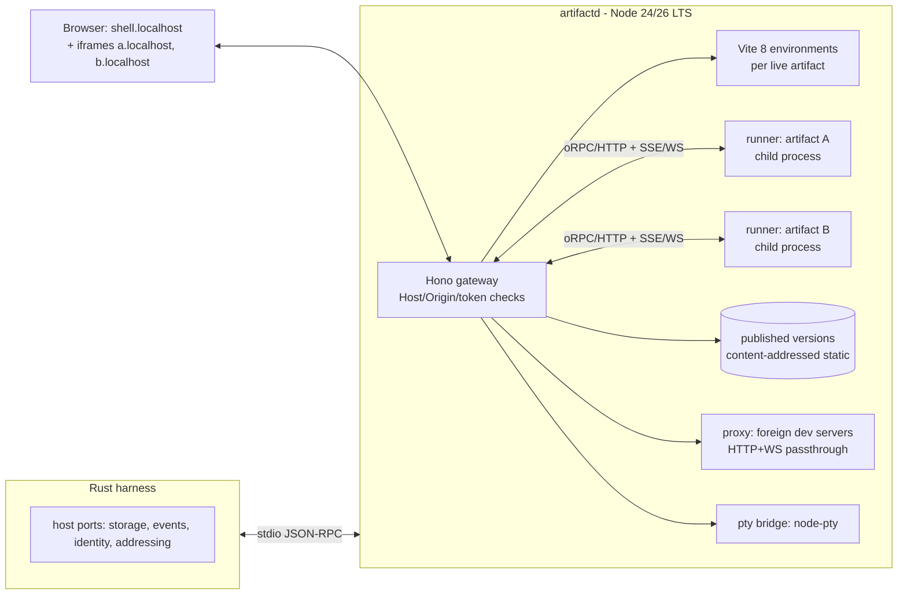

# Runtime and Architecture for an Agent-Authored React Artifact Toolkit (October 2026)

**Recommendation: build one long-lived Node.js "artifact host" daemon. It runs Vite 8 with a toolkit-owned convention: client React plus `*.server.ts` server functions exposed over a typed RPC layer on Hono. Give each artifact its own `*.localhost` origin, run artifact server code in per-artifact child processes, and freeze published versions as content-addressed static builds. Treat React Server Components as an opt-in layer behind the same API, not the foundation.** As of October 2026, RSC outside Next.js is still labeled experimental or unstable in every Vite-based option, and RSC has had a CVSS 10.0 remote-code-execution bug. For a local server that must be safe from third-party websites, both of those matter.

## TL;DR

- **Rendering model:** Use Vite 8 with a React SPA and toolkit-compiled server functions over Hono RPC (Architecture A). It is the most stable, most framework-neutral and most agent-friendly option. Keep RSC (via `@vitejs/plugin-rsc`) as a later opt-in "server components" mode once it leaves 0.x. Do not build on Next.js: it is per-app, config-heavy and Vercel-shaped, with a slow cold start.
- **Runtime and distribution:** Use Node.js, pinning 24 LTS now and moving to 26 LTS after Oct 28, 2026. Ship it as a sidecar the Rust host spawns, with stdio JSON-RPC for control and loopback HTTP/WebSocket for browsers. Keep Bun as a tested secondary runtime (its Aug 2026 Rust rewrite is too fresh) and do not embed a JS engine in Rust. Serve dependencies from a preinstalled, pre-bundled curated set; install arbitrary npm packages on demand into a shared content-addressed store, with a lockfile per artifact.
- **Isolation, versioning, foreign apps:** Run one daemon with origin-per-artifact routing (`<artifact>.localhost:<port>`). Enforce Host-allowlist, Origin and token checks, and contain crashes per artifact. Bind every submission to an immutable version hash. Bring in foreign apps by reverse-proxying their own dev servers on their own subdomain origin with WebSocket passthrough. Avoid WebContainers and Nodebox as core dependencies: commercial use requires a license or is restricted.\[1\]

---

## Key Findings (verified facts, with dates)

### React and RSC-capable frameworks

| Item | Status (verified) | License / maintenance signal | Implication |
|---|---|---|---|
| **React** | 19.2 shipped Oct 1, 2025 (`<Activity>`, `useEffectEvent`, `cacheSignal`, Web Streams SSR in Node).\[2\] The react.dev site header shows v19.3; Next.js 16.4 (Oct 6, 2026) ships React 19.3.\[3\]\[4\] | MIT, Meta; regular minors | The base layer is stable. Target React 19.3. |
| **RSC security record** | CVE-2025-55182 ("React2Shell") was disclosed Dec 3, 2025: "unauthenticated remote code execution vulnerability in React Server Components," CVSS 10.0. It affected `react-server-dom-webpack/parcel/turbopack` 19.0, 19.1.0, 19.1.1 and 19.2.0, plus frameworks including `next`, `react-router`, `waku`, `@parcel/rsc` and `@vitejs/plugin-rsc`.\[5\] Follow-ups: CVE-2025-55184 and CVE-2025-67779 (DoS, 7.5), CVE-2025-55183 (source-code exposure, 5.3) and CVE-2026-23864 (DoS, 7.5, Jan 26, 2026). Safe versions are 19.0.4, 19.1.5 and 19.2.4; the earlier "fixes" 19.0.3, 19.1.4 and 19.2.3 were incomplete.\[3\] | — | The Flight deserializer is an attack surface reachable by any request.\[3\] For a local daemon this argues against making RSC mandatory. |
| **`@vitejs/plugin-rsc`** | Official Vite plugin, still 0.5.x (0.5.31–0.5.33 in Aug–Sep 2026; 0.5.35 seen downstream).\[6\]\[7\]\[8\] React Router's docs call it "experimental." Storybook's vitest-plugin-rsc pins it ("keep @vitejs/plugin-rsc on 0.5.26"), and a Payload adapter reports that "0.5.26 fails the build; 0.5.36 trips a React Router build invariant."\[9\]\[10\]\[11\] | MIT, vitejs org, very active | Real and improving, but patch-level breakage is still common. |
| **Next.js** | 16 shipped Oct 21, 2025 (Turbopack default, Cache Components).\[12\] 16.4 shipped Oct 6, 2026 with Cache Components on by default in `create-next-app`; Next 17 is slated to make them the framework-wide default.\[4\]\[13\] | MIT, Vercel | Mature RSC, but one heavy app per project, with its own conventions and caching model. That is a poor fit for many zero-config artifacts per daemon. |
| **Waku** | 1.0-beta May 12, 2026 (Vite 8/Rolldown, Node 26 support).\[14\] 1.0-RC Aug 25, 2026.\[15\] v1.0.0-rc.3 on Oct 6, 2026 still includes "breaking(router): redesign defineRouter around route resolvers."\[16\] Requires React 19.3.\[17\] | MIT, Daishi Kato; active | The cleanest minimal RSC framework (Vite and Hono),\[14\] but not yet 1.0 and still breaking in the RC. Good prior art. |
| **React Router** | v8 shipped Jun 17, 2026 (Node 22.22+, React 19.2.7+, Vite 7+ for framework mode; ESM-only);\[18\] v8.4.0 is current.\[19\] RSC is still `unstable_`, "subject to breaking changes in minor/patch releases."\[11\] The team said RSC stability "will come in a minor version."\[20\] | MIT, Shopify/Remix | Strong option once RSC stabilizes. Today it is "unstable." |
| **TanStack Start** | Docs still say "Release Candidate"; the API is "considered stable"; npm is on the 1.168.x line. Supports Vite and Rsbuild.\[21\]\[22\] RSC "is experimental in TanStack Start RC and will remain experimental into early v1." Its RSC model avoids parsing Flight from the client.\[23\] | MIT | Good server-function ergonomics (`createServerFn`), but app-shaped, with file-based routing and codegen per app. |
| **Parcel RSC** | Beta since Parcel v2.14.0 (Mar 18, 2025); "Parcel is not a full framework."\[24\] No stable announcement found. | MIT | Niche. Skip. |
| **Vite** | Vite 8.0 stable Mar 12, 2026, with Rolldown as the single default bundler\[25\]\[26\] and Oxc transforms.\[27\] VoidZero's "Announcing Rolldown 1.0" (May 7, 2026) says Rolldown "reached 1.0 stable and production readiness… the ^1.0.0 API is now locked." | MIT, VoidZero | The right foundation: Environment API, multiple module graphs per process, fast cold builds. |

### RPC layer

| Library | Latest (verified) | Notes |
|---|---|---|
| **Hono** | v4.13.13, Oct 4, 2026.\[28\] v4.13.10 moved runtime adapters to separate packages (e.g. `@hono/bun`); "hono/\<adapter\> is deprecated and will be removed in v5."\[29\] | Web-standard Request/Response. Runs on Node, Bun and Deno. Waku uses it.\[14\] Ideal as the daemon's HTTP core. |
| **oRPC** | v1.15.5, Oct 7, 2026 (repo moved to `middleapi/orpc`); v2 in beta.\[30\]\[31\] | Typed RPC with OpenAPI output and streaming. A good fit for the generated server-function clients. Pin v1. |
| **tRPC** | v11.19.0, Sep 16, 2026.\[32\] | Mature, but React-Query-centric and router-object-shaped. More ceremony than agents need. |

(Hono and tRPC licenses are believed to be MIT; oRPC is described as MIT by a secondary source.\[33\] Verify the LICENSE files before release.)

### JS runtimes and single-binary options

| | **Node.js** | **Bun** | **Deno** |
|---|---|---|---|
| Current | 26.x Current (26.0 May 5, 2026), LTS from **Oct 28, 2026**, EOL Apr 30, 2029.\[34\] 24 is Active LTS (supported through Apr 2028).\[35\] | 1.4 (Aug 20, 2026): "rewrites Bun in Rust," Node.js 26.3.0 compatibility, Windows ARM64. 1.4.1 fixed 202 issues; 1.4.2 Sep 5, 2026 fixed regressions.\[36\] | 2.9 (Jun 25, 2026); 2.9.6 Aug 27, 2026.\[37\] Node 26 compatibility target.\[37\]\[38\] |
| TypeScript | Type stripping on by default since 22.18/23.6, Stable in 24.12/25.2.\[39\] `--experimental-transform-types` removed in 26, so enums, parameter properties and decorators need a build step.\[35\] | Native TS/JSX | Native TS |
| Single binary | `node --build-sea` since 25.5.0 (Jan 26, 2026) replaces the postject workflow. The target binary must match the Node version that builds it.\[40\]\[41\] | `bun build --compile` with cross-compile (`--target=bun-linux-x64`, `bun-windows-x64`, `bun-windows-arm64`…), `--bytecode`, embedded assets.\[42\]\[43\] Bun 1.4 notes "dlopen() works on libraries embedded via bun build --compile."\[44\] | `deno compile` (5 targets); `--bundle` is experimental; `deno desktop` is experimental.\[45\] |
| Ownership | OpenJS Foundation. Per the Node.js Releasers' "Evolving the Node.js Release Schedule": "Starting with 27.x, Node.js will move from two major releases per year to one… Every release becomes LTS" (27.0.0 due Apr 2027). | Acquired by Anthropic (announced Dec 2–3, 2025). Stays "open-source & MIT-licensed."\[46\]\[47\]\[48\] | Deno Land Inc., MIT\[37\] |
| Risk for us | Lowest. Vite, Rolldown and the whole ecosystem test on Node first. | A brand-new Rust core means a regression window. Strong `--compile` story. | Good, but npm/Vite edge cases and a third-party ecosystem stance. |

**Embedding a JS engine in Rust (verified signals):**
- `deno_core` is at 0.412.0 (Sep 16, 2026) with "370 breaking releases." It provides no Node APIs, no `fetch`, no TypeScript and no npm, so Vite cannot run on it without rebuilding most of Deno.\[49\]\[50\]
- `rusty_v8` is stable and semver'd (since 129.0.0), but it is only bindings.\[51\]

Boa and QuickJS/rquickjs were not re-verified in this pass. Architecturally they cannot run Vite or Rolldown either.

### Browser and network security facts

- **Vite host check:** Vite checks the Host header against `server.allowedHosts`.\[52\] Localhost, `.localhost` subdomains and all IP addresses are allowed by default; "When using HTTPS, this check is skipped." Setting it to `true` "allows any website to send requests to your dev server through DNS rebinding attacks, allowing them to download your source code."\[53\] Since 6.0.9, `server.cors` defaults to false.\[54\]
- **Chrome Local Network Access (LNA):** Chrome 142 enforces it, gating public-origin requests to loopback and private addresses behind a permission prompt. Same-space requests (localhost→localhost) don't prompt.\[55\] Chrome 145 split the permission into `local-network` and `loopback-network`.\[56\] Iframes need an `allow` delegation;\[57\] Chrome 146 only adds an enterprise policy (`LocalNetworkAccessPermissionsPolicyDefaultEnabled`) for subframe inheritance, and per Google's modern-web-guidance issue #1127, "Chrome 147 expands Local Network Access restrictions to include WebSocket and WebTransport connections," which matters for the live channel. The same source states: "In Chrome 156, the LocalNetworkAccessRestrictionsTemporaryOptOut policy will be removed" (stable scheduled Oct 20, 2026).
- **In-browser runtimes:**
  - **Sandpack** is Apache-2.0.\[1\]\[58\]
  - **Nodebox** is under a "Sustainable Use License" ("only for your own internal business purposes or for non-commercial or personal use"). Sandpack's FAQ says Nodebox templates "have some restrictions on commercial usage."\[1\]\[59\]
  - **WebContainers:** StackBlitz's ToS says "Use in a production or commercial setting, or beyond the stated limits, requires an active plan or separate written license."\[60\] The `webcontainer-core` repo is MIT, but it is only an issue tracker;\[61\] the runtime itself is proprietary.
- **esm.sh** serves npm packages as ESM over HTTP for import maps and is self-hostable.\[62\]\[63\]

---

## Details

### 1. Server and rendering model

**What the toolkit actually needs from "server":**
- Loaders: read files, call local or online APIs.
- Actions: "Send" buttons, form submissions.
- Live data: SSE or WebSocket push when data changes.
- Streaming for long agent-side operations.

All of these are well served by **typed server functions plus a push channel**. RSC adds server-rendered component trees and smaller client bundles. Those are useful for content-heavy public sites, but marginal for local dashboards where the client is on the same machine.

**Agent-authoring simplicity (judgment).** LLM agents are most reliable with the most-trained-on idiom: a `.tsx` component plus a plain async function they can call. RSC adds the `"use client"`/`"use server"` boundary, serializability rules and two module graphs. That is a frequent source of confusing errors, and the agent cannot see them without screenshots. A toolkit-owned convention is easier to lint, explain and error-report: `export async function sendReply(...)` in `actions.server.ts`, imported from the component like any function.

| Criterion | **A: Vite 8 SPA + compiled server functions (Hono/oRPC)** | **B: RSC via `@vitejs/plugin-rsc` (Waku-style)** | **C: Next.js / TanStack Start / RR8 per artifact** |
|---|---|---|---|
| Agent simplicity | ★★★ one boundary rule (`*.server.ts`) | ★★ client/server directive rules | ★ framework conventions, config, routing files |
| Zero-config per artifact | ★★★ toolkit owns all config | ★★ toolkit owns config; RSC entry wiring is internal | ★ project scaffolding per artifact |
| HMR | ★★★ Vite React Fast Refresh | ★★ RSC HMR works, with CSS HMR fixes still landing (0.5.25)\[7\] | ★★ good inside each app |
| Actions, loaders, streaming | ★★★ RPC + SSE/WebSocket; stream via async iterators | ★★★ native Server Functions, Suspense streaming | ★★★ native |
| Startup with many artifacts | ★★★ one process, one Vite server, many environments or lazy servers | ★★ heavier per-artifact graphs (rsc/ssr/client) | ★ one dev server per artifact, seconds each |
| Stability (Oct 2026) | ★★★ Vite 8 and Hono stable | ★ 0.x; "experimental"; CVE history | ★★ Next stable; RR8 RSC unstable; Start RC |
| Lock-in | Low (your convention compiles to plain HTTP) | Low–medium (React Flight protocol) | High (framework semantics) |
| Static export of frozen versions | ★★★ trivially `vite build` | ★★ needs prerender support | ★★ framework-specific |

**Decision:** A now. Design the server-function convention so the same `*.server.ts` file can later be served as RSC Server Functions (Architecture B) without authors changing code. Ship B as an experimental `mode: "rsc"` when `@vitejs/plugin-rsc` hits 1.0 and React Router or Waku RSC stabilizes.

### 2. JS runtime, distribution and the Rust host

**Runtime choice (judgment):**
- **Use Node** as the reference runtime: pin 24 LTS now, move to 26 LTS when it goes LTS on Oct 28, 2026.\[34\] Vite 8, Rolldown's native bindings, Lightning CSS, `node-pty` (TUI) and most npm packages are tested on Node first.
- **Keep Bun in CI as a secondary target.** Bun is very attractive (fast install, `--compile`, Anthropic-backed). But the 1.4 core rewrite in Rust (Aug 20, 2026), followed by a 202-issue fix release two weeks later,\[36\] is exactly the regression window an "enterprise-grade" toolkit should not depend on.
- **Use Node's native type stripping** for the toolkit's own source. Note that Node 26 removed transform-types, so the toolkit must not use enums or parameter properties.\[35\]

**Distribution:**
- Ship a **per-platform "runtime bundle"**: a pinned Node binary, the toolkit's pre-built JS, and a pre-populated `node_modules` containing the platform's native binaries. Do this instead of insisting on a single executable.
- Native `.node` addons (Rolldown, Lightning CSS, node-pty) are the hard part of every single-binary path. Node SEA supports embedded assets\[64\] but expects native addons on disk. Bun documents embedded dlopen.\[44\]
- Offer a `bun build --compile` single binary as a convenience CLI build later, once the Bun 1.4 line settles.
- The Rust host can download, verify and cache the runtime bundle by hash, much as rustup or Playwright manage browsers.

**How the Rust host talks to it:**

```
┌──────────────────────── Rust harness ────────────────────────┐
│ spawns: artifactd --control=stdio --listen=127.0.0.1:0       │
│                                                              │
│  stdio (JSON-RPC 2.0, newline-delimited)                     │
│   ├─ host→toolkit: open/publish/close artifact, set ports,   │
│   │                 storage/identity/addressing port replies │
│   └─ toolkit→host: ready{port}, submission{artifact,version, │
│                    payload}, log, crash, screenshot-ready    │
└──────────────────────────────┬───────────────────────────────┘
                               │ (browser traffic never via stdio)
                    http/ws on 127.0.0.1:<port>
                               │
                     Browser / phone via user's tunnel
```

- **Control plane on stdio JSON-RPC.** There is no port to discover or secure; it dies with the parent; and it maps cleanly to LSP/MCP-style tooling in Rust (`serde_json` and line framing).
- **Data plane on loopback HTTP/WebSocket**, bound to `127.0.0.1` with an ephemeral port reported back in `ready`.
- **Host ports** (storage, events, identity, addressing, trusted controls) are JSON-RPC methods the toolkit calls on the host. The CLI build provides default in-process implementations: SQLite or JSON files, a local identity, and `*.localhost` addressing.
- **Embedding V8 or QuickJS in Rust is rejected.** You would have to reimplement Node APIs to run Vite, `deno_core` churns weekly (370 breaking releases), and crash containment is worse because one engine panic takes down the harness.\[49\]\[50\]

### 3. Dependencies without per-artifact `npm install`

| Strategy | Offline | Reproducible | Arbitrary npm | Cold start | Verdict |
|---|---|---|---|---|---|
| Curated preinstalled bundle (React 19.3, charts, motion, UI kit, MDX, xterm.js…), pre-optimized | ✅ | ✅ (pinned with the toolkit version) | ❌ alone | Instant | **Base layer** |
| Import maps → public esm.sh / jspm CDN | ❌ | ⚠️ CDN rebuilds | ✅ | Network-bound | Fallback only. It also leaks usage to a third party. |
| Self-hosted esm.sh | ✅ after cache | ⚠️ | ✅ | Medium | Viable, but a second build pipeline |
| **On-demand install into a shared content-addressed store** (pnpm store or Bun's global store) + **per-artifact lockfile** | ✅ after first fetch | ✅ | ✅ | Fast with hard-linking | **Arbitrary-package layer** |

**Recommended mechanism (judgment):**
1. **Curated set.** The toolkit's own `node_modules` provides the curated set. A resolver plugin makes bare imports like `react`, `recharts` or `motion` resolve there for every artifact with no install. Use a single React copy (avoid duplicate-React hook errors) and prebuild it once with Vite's dependency optimizer, cached by toolkit version.
2. **Unknown packages.** When the agent imports an unknown package, the daemon either fails fast with a structured message ("run `artifact add <pkg>`") or auto-installs, depending on host policy. The package goes into a per-artifact `deps/` with its own `package.json` and lockfile, hard-linked from a shared pnpm content-addressable store. The curated packages are declared as `peerDependencies` overrides, so React stays singular.
3. **Offline.** A missing package produces a clear error, not a hang. The curated set always works.
4. **Version binding.** The lockfile hash becomes part of the artifact version hash (§5).

(pnpm store and Bun global-store specifics were not re-verified in this pass. Bun 1.4 announces "an opt-in global virtual store for up to 7× faster installs.")\[36\]

### 4. Many artifacts at once

**One daemon, many origins, contained server code:**

```
                        artifactd (Node, one process)
 ┌──────────────────────────────────────────────────────────────────┐
 │ Hono gateway :PORT                                               │
 │  Host routing:  <a1>.localhost ─┐   <a2>.localhost ─┐            │
 │                 shell.localhost │   (toolkit UI)    │            │
 │  Security: Host allowlist → Origin check → session token        │
 │                                 ▼                   ▼            │
 │  Vite 8 dev server(s): one per active artifact, lazily created,  │
 │  idle-evicted (shared dep cache, shared curated bundle)          │
 │                                                                  │
 │  Server-function runners: child process per artifact             │
 │   (node --conditions=artifact-server, IPC; timeouts, mem caps,   │
 │    restart on crash; kill on infinite loop)                      │
 │                                                                  │
 │  Live channel: SSE/WebSocket hub (data changes, HMR, submissions)│
 │  Ports to host: storage | events | identity | addressing         │
 └──────────────────────────────────────────────────────────────────┘
```

- **Origin per artifact.** Use `<artifact-id>.localhost:<port>` rather than paths. Paths share one origin, so artifact A's JavaScript could read artifact B's storage, cookies and `fetch` its RPC endpoints. Ports alone don't isolate cookies (cookies ignore ports); subdomains with host-only cookies do. Vite already allows `.localhost`.\[53\] *Caveat:* Chromium and Firefox "bind localhost to the loopback and bypass the DNS resolver," but Safari does not: in WebKit Bugzilla #160504 ("Localhost subdomains don't work"), a WebKit engineer says "As long as 'ping mysite.localhost' doesn't work in Terminal, I wouldn't expect Safari to behave any differently." Keep a port-per-artifact fallback mode in the addressing port; Safari needs it.
- **Crash containment.** Vite's transform pipeline is shared and trusted. Artifact-authored server code is untrusted for stability (not for security, per your no-guardrails stance), so it runs in a child process per artifact. A `while(true)` in one artifact's action then never freezes the daemon. Client crashes are naturally contained by the browser tab.
- **Resource use.** Lazily start a Vite dev environment only when an artifact is opened in live mode and evict it after idle. Published versions are static files and cost nothing.

### 5. Versioning: live versus frozen

- **Live preview:** the Vite dev server serves the artifact's working directory with HMR while the agent edits.
- **Publish:** compute `versionId = sha256(source tree ∥ lockfile ∥ toolkit version ∥ curated bundle version)`. Run `vite build` into `store/<artifact>/<versionId>/`, which is immutable. The server-functions bundle is built alongside it.
- **Submission binding:** every form, review or comment submission carries `{artifactId, versionId, schemaHash, fieldPath}`. The page gets `versionId` from the build, and the server rejects submissions for unknown versions. A live-mode submission is stamped with a snapshot hash computed at page load, and the toolkit auto-publishes that snapshot so the exact UI the human saw is reproducible.
- **Static export:** use the same build with server functions stubbed. Each call either throws "read-only" or returns recorded responses captured at publish time. Package it as a directory or a single HTML file.

### 6. Embedding foreign apps and TUIs

| Approach | Fidelity | Framework coverage | License risk | Verdict |
|---|---|---|---|---|
| **Reverse-proxy the agent's own dev server** on its own subdomain (`<app>.<artifact>.localhost`) with HTTP and WebSocket upgrade passthrough | Exact | Any framework or language | None | **Primary** |
| Path-prefix proxy (`/apps/x/`) | Breaks absolute URLs, HMR client paths, cookies | Needs `base` config per framework | None | Avoid |
| Port passthrough (iframe straight to `localhost:5173`) | Exact | Any | None | Fallback. It fails over a phone tunnel and bypasses your auth. |
| Sandpack (client-only bundling) | Good for small React snippets | Client-side only | Apache-2.0 | Optional "snippet" mode |
| Nodebox | Partial Node | Limited | Sustainable Use License, commercial restrictions\[1\]\[59\] | Reject |
| WebContainers | High | Broad | Commercial production use needs a paid license\[65\]\[66\] | Reject as core; maybe a host-provided plugin |
| esbuild-wasm in the browser | Client-only | React SPA snippets | MIT | Unnecessary when a local server exists |

**Proxy practicalities:**
- **Vite foreign apps** reject unknown Host headers.\[52\]\[67\] Rewrite the `Host` header to `localhost:<port>` upstream, or have the agent add `.localhost` (already allowed by default). The HMR client may need `server.hmr.clientPort` set to the proxy's port when it's behind the gateway.
- **WebSocket upgrades** must be forwarded verbatim.
- **Strip `X-Frame-Options` and `frame-ancestors`** from the agent's own dev server only, never globally.
- **TUI fidelity:** spawn the program under `node-pty` in the artifact's runner and render with xterm.js (WebGL renderer) over a WebSocket. This is the ttyd model, and ttyd is good reference prior art. (xterm.js and ttyd licenses were not re-verified here; both are believed MIT.)

### 7. Local-server security hygiene (in scope per your commitments)

1. **Bind loopback only.** Remote access goes through the user's tunnel or VPN, terminating at loopback.
2. **Host allowlist** (DNS-rebinding defense): accept only `localhost`, `*.localhost`, `127.0.0.1`, `[::1]` and explicitly configured tunnel hostnames. Never use Vite's `allowedHosts: true`.\[68\]\[69\]
3. **Origin check** on every non-GET request and every WebSocket upgrade. The `Origin` header must equal the artifact's own origin or the shell origin. No permissive CORS.
4. **Capability token.** The launch URL carries a one-time token that is exchanged for a host-only, `SameSite=Strict`, `HttpOnly` cookie per origin. RPC also requires a custom header (CSRF belt-and-braces).
5. **LNA is defense-in-depth, not the defense.** Chrome now prompts before public sites can reach loopback,\[55\] but other browsers and older Chromes differ, and users click "Allow."
6. **Trusted controls** (e.g. a host-rendered "Send" confirmation) are rendered by the shell origin, which wraps the artifact iframe, so artifact JavaScript cannot spoof them.

---

## Candidate architectures

### Architecture A: "Vite host + compiled server functions" (recommended)



**Pros:**
- Stable dependencies only.
- One boundary rule for agents.
- Fast multi-artifact startup.
- Static export is trivial.
- No Flight endpoint exposed.

**Cons:**
- You own a small compiler plugin (server-function stubs and type-safe client generation).
- No server-rendered component trees.

### Architecture B: "RSC-native host" (watch; adopt as opt-in mode)

The same daemon, with each artifact built by `@vitejs/plugin-rsc` (rsc, ssr and client environments) and Server Functions native. Waku is the closest prior art.

**Pros:**
- The idiomatic React 19 model.
- Streaming server components.
- Smaller client bundles.

**Cons:**
- 0.x plugin, with patch-level breakage reported downstream.
- Directive errors are hard for blind agents to debug.
- A Flight deserialization attack surface with a CVE history.
- Heavier per-artifact graphs.

**Overturn trigger:** `@vitejs/plugin-rsc` 1.0, React Router RSC stable, and six months with no new critical RSC advisories.

### Architecture C: "Process per artifact with a real framework"

Each artifact is a full Next.js 16.4, TanStack Start or React Router 8 app on its own port, fronted by the gateway, which is reused from A's proxy.

**Pros:**
- Maximum framework features.
- Hard OS-level isolation.

**Cons:**
- Seconds-plus cold start and hundreds of MB per artifact.
- Per-artifact scaffolding and config that agents must maintain.
- Framework lock-in.
- Hard to bind submissions to versions uniformly.

**Use:** only as the foreign-app path (§6), not the native artifact model.

### Comparison and ranking

| | A | B | C |
|---|---|---|---|
| Agent authoring | Best | Medium | Worst |
| Stability today | High | Low–medium | Medium–high |
| Multi-artifact cost | Low | Medium | High |
| Isolation | Origin + process for server code | Same as A | OS process per app |
| Security surface | Small (typed RPC) | Larger (Flight) | Framework-dependent |
| Static export / versioning | Easy | Medium | Hard |
| Future-proofing | Upgrade path to B | Native | Proxy path covers it |

**Ranked recommendation:**
1. **A.** It is the only option where every dependency is stable today and the authoring model is one rule.
2. **B, as an opt-in mode behind the same API**, once the overturn triggers are met.
3. **C, reserved for foreign apps** via proxy.

**What would overturn A:**
- The React team declares RSC plus Server Functions stable in Vite with a 1.0 plugin, and agents demonstrably author RSC with fewer errors than RPC (measure this in your eval harness).
- Or a host needs server-rendered output for non-JS consumers.

**What would overturn Node:**
- Bun 1.4.x passes your full Vite 8 + Rolldown + node-pty matrix for two consecutive minors with no regressions, and `--compile` single binaries prove materially simpler for the Rust host's installer.

---

## Recommended monorepo decomposition

```
packages/
  core/              # artifact model, versionId hashing, manifest schema, errors (pure TS, no IO)
  protocol/          # JSON-RPC control-plane types + host-port interfaces (storage, events,
                     # identity, addressing, trusted-controls); published as JSON Schema for Rust codegen
  daemon/            # artifactd: lifecycle, process supervision, stdio control server
  gateway/           # Hono app: Host/Origin/token middleware, origin routing, static serving
  vite-plugin/       # toolkit's Vite 8 plugin: curated-dep resolver, *.server.ts → RPC stubs,
                     # version injection, MDX, error overlay → structured agent errors
  rpc/               # oRPC-based server-function runtime + client, SSE/WS live channel
  runner/            # per-artifact child-process host for server functions (timeouts, mem caps)
  deps/              # curated bundle manifest, prebuild/optimize step, on-demand installer
                     # (pnpm store), per-artifact lockfiles
  publish/           # vite build → content-addressed store; static export; recorded-response stubs
  submissions/       # form/review/comment capture, version binding, default SQLite storage adapter
  proxy/             # foreign dev-server reverse proxy (HTTP+WS), header rewriting
  pty/               # node-pty + xterm.js bridge for TUI artifacts
  shell/             # toolkit UI (artifact list, version switcher, trusted controls host frame)
  sdk/               # what agents import: <Form>, useSubmit(), useLive(), <ReviewSet>, <Deck>,
                     # <Terminal>, theming — "beautiful by default"
  ui/                # design system (tokens, components, charts wrappers)
  cli/               # `artifact new|dev|publish|export|add` — thin over daemon protocol
  screenshot/        # optional Playwright-based capture so blind agents can see results
  rsc-mode/          # (experimental, later) @vitejs/plugin-rsc integration behind same sdk API
adapters/
  host-rust/         # Rust crate: spawn + JSON-RPC client + host-port traits (lives in repo for lockstep)
  storage-sqlite/  storage-fs/  addressing-localhost/  addressing-port/
distribution/
  runtime-bundle/    # per-platform Node + prebuilt node_modules tarballs, signed, hash-pinned
  bun-compile/       # (secondary) single-binary build
```

**Prior art and what to borrow (judgment; not re-verified in this pass):**
- **Claude Artifacts, v0, Bolt.new and Lovable:** the agent-writes-React loop. Bolt runs on WebContainers, which is why its licensing matters here.
- **Observable Framework and Evidence.dev:** data loaders that run at build time, then static output. This is the model for "published/frozen" versions with recorded data.
- **Streamlit and Gradio:** a server-driven rerun model with a websocket session. This is the model for live data views; we invert it with a client-owned UI.
- **Storybook:** many isolated "stories" in one Vite server, which is direct precedent for many artifacts per daemon. Storybook is also tracking Vite 8 and RSC.\[9\]\[70\]
- **Slidev:** Vite-based decks from Markdown, a model for MDX presentations.
- **Remotion:** React motion graphics. Check its company license for commercial users before bundling.
- **marimo and Jupyter Server:** token-in-URL auth and Origin/XSRF checks for local servers. This is the model for §7.
- **ttyd and xterm.js:** TUI fidelity.
- **Val Town:** server functions as plain exported functions.

## Caveats

- **Version numbers move weekly.** Some data points, such as Bun binary size, come from secondary sources and should be re-checked at implementation time. The Rolldown 1.0 date, the Node 27 cadence and the Chrome 146/147/156 LNA details are now confirmed from VoidZero, Node.js Releasers and Google sources.
- **Unverified in this pass:** pnpm/Bun store mechanics, Boa/QuickJS status, and the xterm.js, ttyd, Remotion, Hono and tRPC licenses. Treat them as to-verify.
- **"No guardrails" is honored for capability** (artifacts can call anything). The process-per-artifact runner is for stability, and the origin isolation exists to stop third-party sites and sibling artifacts from riding the user's session. It is not a sandbox against the agent itself.

## Sources

1. [Frequently Asked Questions - Sandpack - CodeSandbox](https://sandpack.codesandbox.io/docs/resources/faq)
2. [React 19.2](https://www.react.dev/blog/2025/10/01/react-19-2)
3. [Denial of Service and Source Code Exposure in React Server Components – React](https://react.dev/blog/2025/12/11/denial-of-service-and-source-code-exposure-in-react-server-components)
4. [Next.js 16.4 Shrinks the Turbopack Cache by Up to a Quarter](https://privatedevops.com/news/nextjs-16-4-smaller-turbopack-cache)
5. [Critical Security Vulnerability in React Server Components – React](https://react.dev/blog/2025/12/03/critical-security-vulnerability-in-react-server-components)
6. [Improved React Server Components support in the Cloudflare Vite plugin · Changelog](https://developers.cloudflare.com/changelog/post/2026-02-11-vite-plugin-child-environments/)
7. [vitejs/vite-plugin-react · DevUpdate.io](https://devupdate.io/explore/vitejs/vite-plugin-react)
8. [Plugin Rsc: React Component Libraries](https://reactlibraryhub.vercel.app/library/vitejs~plugin-rsc)
9. [Release v0.2.5 · storybookjs/vitest-plugin-rsc](https://github.com/storybookjs/vitest-plugin-rsc/releases/tag/v0.2.5)
10. [React Server Components](https://reactrouter.com/how-to/react-server-components)
11. [GitHub - sakuga-software/payload-react-router: React Router v8 (RSC framework mode) adapter for the Payload CMS admin panel and REST/GraphQL API · GitHub](https://github.com/sakuga-software/payload-react-router)
12. [Next.js 16: Complete Guide to Cache Components, Turbopack, and Revolutionary Features - Nandann Creative Agency](https://www.nandann.com/blog/nextjs-16-release-comprehensive-guide)
13. [Next.js 16.4: Cache Components Default, React 19.3](https://byteiota.com/nextjs-16-4-cache-components-react-19-3/)
14. [Waku 1.0 (beta) — Waku](https://waku.gg/blog/waku-v1-beta)
15. [Waku 1.0 (RC) — Waku](https://waku.gg/blog/waku-v1-rc)
16. [Release v1.0.0-rc.3 · wakujs/waku](https://github.com/wakujs/waku/releases/tag/v1.0.0-rc.3)
17. [Release v1.0.0-rc.1 · wakujs/waku](https://github.com/wakujs/waku/releases/tag/v1.0.0-rc.1)
18. [React Router v8](https://remix.run/blog/react-router-v8)
19. [CHANGELOG.md](https://reactrouter.com/changelog)
20. [React Router v8 · remix-run/react-router · Discussion #14468](https://github.com/remix-run/react-router/discussions/14468)
21. [What Is TanStack Start? A 2026 Guide for React Developers](https://makerkit.dev/blog/tutorials/what-is-tanstack-start)
22. [TanStack Start Overview](https://tanstack.com/start/latest/docs/framework/react/overview)
23. [React Server Components Your Way](https://tanstack.com/blog/react-server-components)
24. [Parcel v2.14.0](https://parceljs.org/blog/v2-14-0/)
25. [Vite 8.0 is out!](https://vite.dev/blog/announcing-vite8)
26. [What Rolldown in Vite 8 Actually Changes for Your Build](https://www.buildmvpfast.com/blog/rolldown-vite-8-rust-bundler-2026)
27. [Vite 8 + Rolldown Migration Guide: Cut Build Times by 87% in 2026](https://www.nexgismo.com/blog/vite-8-rolldown-migration-guide-2026)
28. [Releases · honojs/hono](https://github.com/honojs/hono/releases)
29. [Hono (@honojs) on X](https://x.com/honojs)
30. [Releases · middleapi/orpc](https://github.com/middleapi/orpc/releases)
31. [oRPC - Typesafe APIs Made Simple 🪄](https://orpc.dev/)
32. [Releases · trpc/trpc](https://github.com/trpc/trpc/releases)
33. [Typesafe APIs Made Simple with oRPC - Zuplo](https://zuplo.com/blog/typesafe-apis-made-simple-with-orpc)
34. [Node 26: What Breaks When You Upgrade (LTS)](https://ortamarco.me/en/blog/what-breaks-upgrading-to-node-26/)
35. [Node.js v26 Upgrade: Temporal by Default, Type Stripping](https://techinsights.manisuec.com/nodejs/nodejs-26/)
36. [Blog](https://bun.com/blog)
37. [Deno (software)](<https://en.wikipedia.org/wiki/Deno_(software)>)
38. [Deno update streamlines creation of desktop apps](https://www.infoworld.com/article/4190648/deno-update-streamlines-creation-of-desktop-apps.html)
39. [Running TypeScript natively in Node.js: 22 vs 24 vs 26](https://codewithnodejs.com/running-typescript-natively-in-node-js-22-24-and-26/)
40. [Node.js — Node.js 25.5.0 (Current)](https://nodejs.org/en/blog/release/v25.5.0)
41. [How to compile JavaScript into a single executable](https://flaviocopes.com/javascript-single-executable/)
42. [Single-file executable](https://bun.com/docs/bundler/executables)
43. [Bun v1.3.10](https://bun.com/blog/bun-v1.3.10)
44. [Bun 1.4](https://bun.com/blog/bun-v1.4)
45. [Deno 2.9](https://deno.com/blog/v2.9)
46. [AI Dev Essentials #35: Anthropic Acquires Bun + TypeScript 7 is 10x Faster](https://egghead.io/ai-dev-essentials-35-anthropic-acquires-bun-type-script-7-is-10x-faster~41cyn)
47. [Bun is joining Anthropic](https://bun.com/blog/bun-joins-anthropic)
48. [anthropic acquires bun as claude code reaches usd1b milestone](https://anthropic.com/news/anthropic-acquires-bun-as-claude-code-reaches-usd1b-milestone)
49. [deno\_core — Rust web dev library // Lib.rs](https://lib.rs/crates/deno_core)
50. [Deno's Other Open Source Projects](https://deno.com/blog/open-source)
51. [Announcing Stable V8 Bindings for Rust](https://deno.com/blog/rusty-v8-stabilized)
52. [Allow for defining \`server.allowedHosts\` through environment variables · Issue #19273 · vitejs/vite](https://github.com/vitejs/vite/issues/19273)
53. [Server Options](https://vite.dev/config/server-options)
54. [\[Security\] Bump vite from 6.0.3 to 6.0.11 (!157) · Merge requests · SSIS / TeachGPT · GitLab](https://git.ssis.nu/SSIS/teachgpt/-/merge_requests/157/pipelines)
55. [Chrome's Local Network Access (LNA) Permission Explained](https://blog.openreplay.com/chrome-local-network-access-lna-permission/)
56. [Chrome 156 Blocks Local Network? How to Grant Access (2026)](https://www.superchargebrowser.com/library/chrome-156-local-network-access)
57. [Best Practices for Configuring Local Network Permissions in Chrome](https://blog.paulserban.eu/post/best-practices-for-configuring-local-network-permissions-in-chrome/)
58. [GitHub - codesandbox/sandpack-bundler: The new bundler/runtime powering client-side sandpack sandboxes · GitHub](https://github.com/codesandbox/sandpack-bundler)
59. [nodebox-runtime/packages/nodebox/LICENSE at main · Sandpack/nodebox-runtime](https://github.com/codesandbox/nodebox-runtime/blob/main/packages/nodebox/LICENSE)
60. [StackBlitz](https://stackblitz.com/terms-of-service)
61. [GitHub - stackblitz/webcontainer-core: Dev environments. In your web app. · GitHub](https://github.com/stackblitz/webcontainer-core)
62. [How to Use](https://esm.sh/:451:5)
63. [esm.sh/README.md at main · esm-dev/esm.sh](https://github.com/esm-dev/esm.sh/blob/main/README.md)
64. [Single executable applications](https://nodejs.org/api/single-executable-applications.html)
65. [General FAQs (Frequently Asked Questions)](https://developer.stackblitz.com/guides/user-guide/general-faqs)
66. [StackBlitz — API Provider, Schemas](https://apis.io/providers/stackblitz/)
67. [Fix "Blocked request: host not allowed" in Strapi 5](https://strapi.io/blog/strapi-vite-allowed-hosts-blocked-request)
68. [Server Options](https://v4.vitejs.dev/config/server-options.html)
69. [Do not disable Vite host protection when binding to 0.0.0.0 · Issue #21 · bilawalsidhu/gods-eye-view](https://github.com/bilawalsidhu/gods-eye-view/issues/21)
70. [Support Vite 8 (Rolldown-powered) · Issue #33789 · storybookjs/storybook](https://github.com/storybookjs/storybook/issues/33789)
